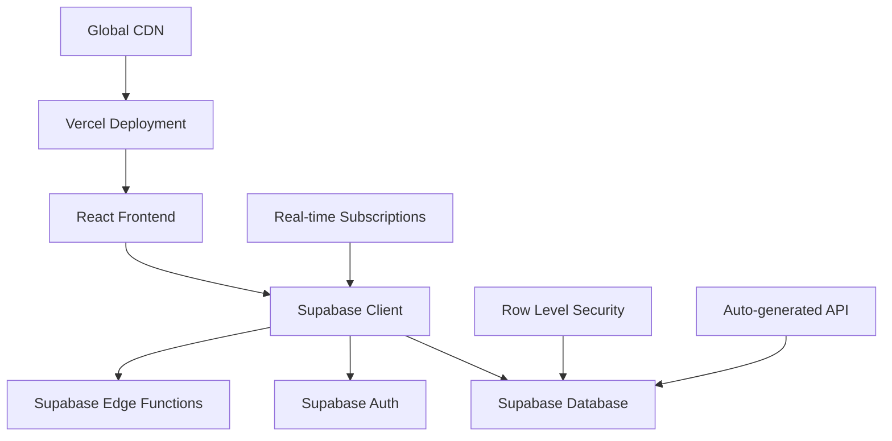
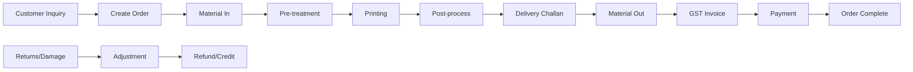

# 🏭 Digital Textile Printing Management System

[](https://supabase.com)
[](https://postgresql.org)
[](https://reactjs.org)
[](https://supabase.com/auth)
[](https://vercel.com)
[](LICENSE)

> **Complete digital workflow management system for textile printing businesses with real-time collaboration, automated order tracking, and comprehensive reporting.**

## 🌟 Features

### 🎯 **Core Business Operations**
- **Customer Management** - Complete customer profiles with GST, contact details, and order history
- **Order Workflow** - End-to-end order processing from creation to delivery
- **Production Tracking** - Real-time tracking through pre-treatment, printing, and post-processing stages
- **Material Management** - Track materials in/out with customer linkage and inventory management
- **Financial Management** - GST invoicing, payment tracking, and receivables management

### 📊 **Advanced Features**
- **Real-time Collaboration** - Multiple users can work simultaneously with live updates
- **Comprehensive Reporting** - 15+ built-in reports with date filtering and export capabilities
- **Role-based Access Control** - Admin, Manager, and Employee roles with granular permissions
- **Audit Trail** - Complete tracking of who created/modified what and when
- **Automated Numbering** - Auto-generated order, challan, and invoice numbers
- **Data Security** - Row-level security, encrypted data, and secure authentication

### 🔧 **Technical Excellence**
- **Modern Tech Stack** - Supabase + Vercel for 100% serverless architecture
- **Real-time Updates** - Live data synchronization across all connected clients
- **Mobile Responsive** - Works perfectly on desktop, tablet, and mobile devices
- **High Performance** - Sub-second response times with global CDN
- **Zero Maintenance** - Fully managed infrastructure with automatic scaling

## 🏗️ **Architecture**



### **Technology Stack**

| Component | Technology | Purpose |
|-----------|------------|---------|
| **Frontend** | React 18 + TypeScript | Modern, type-safe UI |
| **Backend** | Supabase (PostgreSQL) | Database, Auth, Real-time |
| **API Layer** | Auto-generated REST + GraphQL | Type-safe API endpoints |
| **Edge Functions** | Deno/TypeScript | Complex business logic |
| **Deployment** | Vercel | Global CDN, automatic scaling |
| **Authentication** | Supabase Auth | JWT-based security |
| **Database** | PostgreSQL 15 | ACID compliance, JSON support |
| **Real-time** | WebSocket subscriptions | Live data updates |

## 🚀 **Quick Start**

### **Prerequisites**
- Node.js 16+ and npm
- Supabase account (free)
- Vercel account (free)

### **1. Setup Supabase Project**

1. **Create Supabase Project**
   ```bash
   # Visit https://supabase.com
   # Click "New Project"
   # Name: [YOUR-CUSTOM-PROJECT-NAME] (can be anything you want)
   # Choose region closest to you
   # Database password: [Generate a strong password]
   ```
   
   > 💡 **Note**: You can use any project name you prefer. The setup script will automatically detect your project details.

2. **Run Migration Setup**
   ```bash
   # Clone and setup
   git clone <your-repo-url>
   cd [YOUR-PROJECT-FOLDER-NAME]  # Use your folder name
   
   # Run automated Supabase migration
   python3 setup_supabase_migration.py
   ```
   
   > 🔧 **The setup script will ask for YOUR specific project details** - no need to match the examples!

3. **Apply Database Schema**
   ```bash
   # Install Supabase CLI (use npx or official installer)
   # Option 1: Use npx (no installation needed)
   npx supabase --version
   
   # Option 2: Official installer (Linux/macOS)
   # curl -fsSL https://supabase.com/install.sh | sh
   
   # Apply schema to your Supabase project
   npx supabase db push
   ```

### **2. Frontend Development**

```bash
# Install dependencies
cd frontend
npm install

# Start development server
npm run dev
```

**Your app will be running at:** http://localhost:3000

### **3. Production Deployment**

```bash
# Install Vercel CLI
npm install -g vercel

# Deploy to production
vercel --prod
```

**🎉 That's it! Your system is live and ready to use.**

## 🎨 **Customization Note**

> 💡 **All project names in this documentation are examples!** 
>
> You can use **any names you prefer**:
> - **Supabase Project**: "MyBusinessApp", "SivaTextiles", etc.
> - **GitHub Repository**: "my-textile-system", "awesome-printing-app", etc.
> - **Domain**: yourbusiness.com, mybrand.app, etc.
>
> The setup script will automatically adapt to **your choices**! 🚀

## 📋 **Default Login Credentials**

```
Username: admin@textile-printing.com
Password: Admin@123!
```

> ⚠️ **Important:** Change the default password immediately after first login.

## 🎯 **User Roles & Capabilities**

### **👑 Admin**
- **Full System Access** - All features and settings
- **User Management** - Create, edit, delete users
- **Data Management** - Edit/delete any record anytime
- **System Configuration** - Modify system settings
- **Advanced Reports** - Access to all reports and analytics

### **👨‍💼 Manager**
- **Business Operations** - All operational features
- **Team Oversight** - View all team activities
- **Data Correction** - Edit records within 7 days
- **Financial Reports** - Access to financial and operational reports
- **Approval Workflows** - Approve corrections and adjustments

### **👥 Employee**
- **Daily Operations** - Order entry, production updates
- **Customer Service** - Customer and material management
- **Basic Reports** - Access to operational reports
- **Own Data** - Edit own entries within 24 hours
- **Limited Access** - No financial or sensitive data

## 📊 **Business Workflow**



### **Key Business Processes**

1. **Order Management**
   - Auto-generated order numbers (ORD-2025-0001)
   - Multiple items per order with individual tracking
   - Status tracking: Pending → In Progress → Completed
   - Customer order history and search

2. **Production Workflow**
   - Three-stage production: Pre-treatment → Printing → Post-process
   - Individual item-level stage tracking
   - Production status dashboard
   - Stage completion timestamps and user tracking

3. **Material Tracking**
   - Material In: Record customer materials with order linkage
   - Material Out: Track dispatched materials via delivery challans
   - Full traceability from receipt to delivery

4. **Financial Management**
   - Multi-challan GST invoices with automatic tax calculation
   - Payment tracking with multiple payment methods
   - Outstanding receivables management
   - Automated payment allocation

## 📈 **Reports & Analytics**

### **📋 Operational Reports**
- **Pending Orders** - All active orders with status tracking
- **Production Status** - Current stage of all order items
- **Material Flow** - In/out tracking with date ranges
- **Daily Operations** - Today's activities summary

### **💰 Financial Reports**
- **Pending Receivables** - Outstanding invoice amounts
- **Payment History** - Received payments with trends
- **Expense Tracking** - Business expenses by category
- **Profit Analysis** - Revenue vs. expenses analysis

### **📊 Business Intelligence**
- **Customer Analytics** - Top customers, order patterns
- **Production Metrics** - Efficiency, bottlenecks, trends
- **Inventory Management** - Stock levels, reorder alerts
- **Performance Dashboards** - Key business metrics

## 🔒 **Security Features**

### **🛡️ Data Protection**
- **Row Level Security (RLS)** - Database-level access control
- **JWT Authentication** - Secure token-based authentication
- **Encrypted Storage** - All data encrypted at rest and in transit
- **Secure API** - Auto-generated secure endpoints
- **Audit Logging** - Complete activity tracking

### **🔐 Access Control**
- **Role-based Permissions** - Granular access control
- **Session Management** - Automatic session timeout
- **Password Security** - Strong password requirements
- **API Security** - Rate limiting and authentication

### **🔍 Compliance**
- **Data Audit Trail** - WHO changed WHAT and WHEN
- **Soft Deletes** - Data recovery capabilities
- **Backup & Recovery** - Automated daily backups
- **GDPR Compliance** - Data protection and privacy

## 🛠️ **Development & Customization**

### **📁 Project Structure**
```
textile-printing-system/
├── frontend/                 # React application
│   ├── src/
│   │   ├── components/       # Reusable UI components
│   │   ├── pages/           # Page components
│   │   ├── services/        # API service functions
│   │   ├── types/           # TypeScript type definitions
│   │   └── lib/             # Utility functions
│   └── public/              # Static assets
├── supabase/                # Database and backend
│   ├── migrations/          # Database schema migrations
│   ├── functions/           # Edge functions (business logic)
│   └── schema.sql          # Complete database schema
├── docs/                    # Documentation
└── backup_fastapi/         # Previous FastAPI backend (backup)
```

### **🔧 Customization Guide**

1. **Adding New Features**
   ```typescript
   // 1. Add to database schema
   // supabase/schema.sql
   
   // 2. Create API functions
   // frontend/src/services/supabaseApi.ts
   
   // 3. Add UI components
   // frontend/src/components/
   
   // 4. Update types
   // frontend/src/types/
   ```

2. **Custom Reports**
   ```typescript
   // Create custom queries in
   // frontend/src/services/reportsApi.ts
   
   export const customReports = {
     async getCustomMetrics() {
       const { data, error } = await supabase
         .from('your_view')
         .select('*')
       return { data, error }
     }
   }
   ```

3. **Business Logic**
   ```typescript
   // Add complex logic to Supabase Edge Functions
   // supabase/functions/your-function/index.ts
   
   Deno.serve(async (req) => {
     // Your custom business logic
     return new Response(JSON.stringify(result))
   })
   ```

### **🔄 Maintenance**

- **Zero-downtime Deployments** - Vercel handles automatic deployments
- **Database Migrations** - Version-controlled schema changes
- **Monitoring** - Built-in Supabase monitoring and alerts
- **Backup Strategy** - Automated daily backups with point-in-time recovery

## 📚 **Documentation**

> 📋 **[Complete Documentation Guide](docs/README.md)** - Start here for organized reading order!

### **🚀 Quick Links**

| Priority | Guide | Description |
|----------|-------|-------------|
| **🔥 High** | [Setup Guide](docs/SETUP_GUIDE_SUPABASE.md) | Environment setup and installation |
| **🔥 High** | [Deployment Guide](docs/DEPLOYMENT_GUIDE_SUPABASE.md) | Production deployment to Supabase + Vercel |
| **📊 Medium** | [API Documentation](docs/API_DOCUMENTATION_SUPABASE.md) | Complete API reference and examples |
| **📊 Medium** | [Testing Guide](docs/TESTING_GUIDE_SUPABASE.md) | Testing strategies and automation |
| **👥 User** | [User Guide](docs/USER_GUIDE.md) | End-user application guide |

### **📖 Reading Order by Role**
- **👨‍💼 Business Owner**: README.md → User Guide → Deployment Guide
- **👨‍💻 Developer**: Setup Guide → API Docs → Testing Guide → Deployment Guide
- **🎓 New Team Member**: README.md → Setup Guide → User Guide → API Docs

## 💡 **Why Supabase + Vercel?**

### **✅ Benefits**
- **🆓 Free Tier** - Perfect for small to medium businesses
- **⚡ Performance** - Global CDN, edge functions, real-time updates
- **🛡️ Security** - Enterprise-grade security out of the box
- **📈 Scalability** - Automatic scaling from 1 to 1M+ users
- **🔧 Developer Experience** - Modern tooling, TypeScript, real-time
- **💰 Cost Effective** - Pay only for what you use, transparent pricing

### **🏆 vs. Traditional Stack**
| Feature | Traditional (FastAPI+Server) | Supabase + Vercel |
|---------|------------------------------|-------------------|
| **Infrastructure** | Manual server management | Fully managed |
| **Scaling** | Manual scaling required | Automatic scaling |
| **Real-time** | Complex WebSocket setup | Built-in real-time |
| **Authentication** | Custom implementation | Ready-to-use auth |
| **Database** | Manual setup & maintenance | Managed PostgreSQL |
| **Deployment** | Complex CI/CD setup | One-click deployment |
| **Monitoring** | Custom monitoring setup | Built-in monitoring |
| **Cost** | Fixed server costs | Pay-per-use |

## 🤝 **Contributing**

We welcome contributions! Please see our [Contributing Guide](CONTRIBUTING.md) for details.

### **Development Setup**
```bash
# 1. Fork and clone the repository
git clone https://github.com/yourusername/textile-printing-system.git

# 2. Setup development environment
python3 setup_supabase_migration.py

# 3. Start development
cd frontend && npm run dev

# 4. Make your changes and submit a PR
```

## 📞 **Support**

- **📧 Email:** support@textile-printing-system.com
- **💬 Discord:** [Join our community](https://discord.gg/textile-printing)
- **📖 Documentation:** [Full documentation](docs/)
- **🐛 Bug Reports:** [GitHub Issues](https://github.com/yourusername/textile-printing-system/issues)

## 📄 **License**

This project is licensed under the MIT License - see the [LICENSE](LICENSE) file for details.

## 🙏 **Acknowledgments**

- **Supabase** - For the amazing backend-as-a-service platform
- **Vercel** - For seamless frontend deployment and hosting
- **React Team** - For the excellent frontend framework
- **PostgreSQL** - For the robust and reliable database

---

<div align="center">
  <h3>🎉 Ready to transform your textile printing business?</h3>
  <p><strong>Get started in 5 minutes with our automated setup!</strong></p>
  
  ```bash
  python3 setup_supabase_migration.py
  ```
  
  <p><em>Built with ❤️ for textile printing businesses worldwide</em></p>
</div>