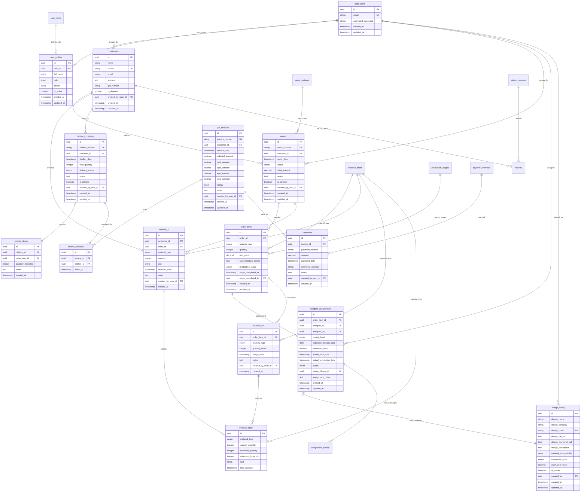

# Database Schema Diagram - Digital Textile Printing System



## Schema Statistics

- **Total Tables**: 24 (21 current + 3 designer tables)
- **Core Business Tables**: 8
- **Reference/Lookup Tables**: 5  
- **Designer Management**: 3
- **Material Management**: 4
- **Financial Management**: 4
- **User Management**: 2

## Key Design Features

### 🔑 **Primary Keys**
- All business tables use UUID primary keys
- Generated using `gen_random_uuid()` function
- Ensures global uniqueness and security

### 🔗 **Relationships**
- **1:M relationships**: 15 primary relationships
- **M:M relationships**: 2 (via junction tables)
- **Self-referencing**: User audit trails

### 📊 **Data Types**
- **UUID**: All primary and foreign keys
- **ENUM**: Status fields for data integrity
- **DECIMAL**: Financial amounts with precision
- **TIMESTAMP WITH TIME ZONE**: Global time compatibility
- **TEXT**: Flexible content storage
- **ARRAY**: PostgreSQL array types for lists

### 🛡️ **Constraints**
- **NOT NULL**: Critical fields enforced
- **UNIQUE**: Business keys like phone, email
- **CHECK**: Quantity validations (> 0)
- **FOREIGN KEY**: Referential integrity
- **DEFAULT**: Automatic timestamps and values

### ⚡ **Indexes** (Recommended)
```sql
-- Performance critical indexes
CREATE INDEX idx_orders_customer_date ON orders(customer_id, order_date);
CREATE INDEX idx_order_items_order ON order_items(order_id);
CREATE INDEX idx_designer_assignments_status ON designer_assignments(status, expected_delivery_date);
CREATE INDEX idx_material_stock_type ON material_stock(material_type);
CREATE INDEX idx_customers_phone ON customers(phone);
CREATE INDEX idx_orders_status ON orders(status);
CREATE INDEX idx_payments_invoice ON payments(invoice_id);
```

## Business Process Flows Through Schema

### **Order-to-Cash Flow**
```
customers → orders → order_items → designer_assignments → 
material_out → delivery_challans → challan_items → 
gst_invoices → invoice_challans → payments
```

### **Material Management Flow**  
```
material_in → material_stock ← material_out ← order_items
```

### **Designer Workflow**
```
order_items → designer_assignments ← design_library
          ↓
assignment_history (audit trail)
```

### **Financial Reconciliation**
```
delivery_challans → invoice_challans ← gst_invoices → payments
```

---
*Diagram generated on: 2025-09-11 17:41:06*
*Schema Version: v3.0 with Designer Management*
