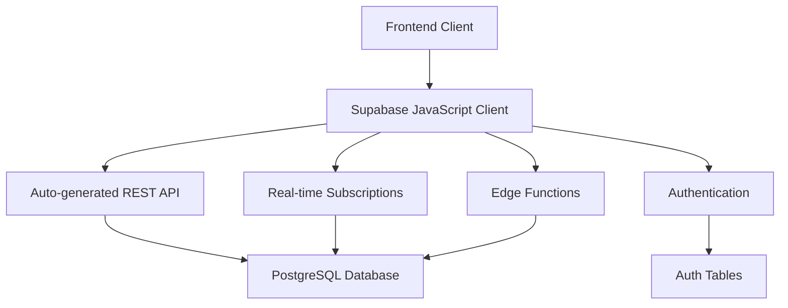

# 📖 API Documentation - Supabase Stack

Complete API reference for the Digital Textile Printing Management System using Supabase.

## 📋 Overview

This system uses **Supabase** which provides:
- 🔄 **Auto-generated REST API** from database schema
- 🚀 **Real-time subscriptions** via WebSocket
- 🔒 **Row Level Security (RLS)** for data protection
- ⚡ **Edge Functions** for complex business logic
- 📊 **Built-in analytics** and monitoring

## 🏗️ API Architecture



## 🔑 Authentication

### **Authentication Flow**

1. **Login** - Get JWT token
2. **Set Token** - Include in all requests
3. **Auto-refresh** - Token automatically refreshed
4. **Logout** - Invalidate token

### **Example: Authentication**

```javascript
// Login
const { data, error } = await supabase.auth.signInWithPassword({
  email: 'admin@example.com',
  password: 'password123'
})

// Get current user
const { data: { user } } = await supabase.auth.getUser()

// Logout
await supabase.auth.signOut()
```

---

## 📚 Table of Contents

1. [👥 Users API](#users-api)
2. [🏢 Customers API](#customers-api)
3. [📦 Orders API](#orders-api)
4. [🏭 Production API](#production-api)
5. [📄 Materials API](#materials-api)
6. [🧾 Invoices API](#invoices-api)
7. [💰 Payments API](#payments-api)
8. [📊 Reports API](#reports-api)
9. [📦 Inventory API](#inventory-api)
10. [💸 Expenses API](#expenses-api)
11. [🔄 Real-time API](#real-time-api)
12. [⚡ Edge Functions](#edge-functions)

---

## 👥 Users API

### **Table: `users`**

```sql
CREATE TABLE users (
    id UUID PRIMARY KEY DEFAULT uuid_generate_v4(),
    username VARCHAR(50) UNIQUE NOT NULL,
    email VARCHAR(255) UNIQUE NOT NULL,
    full_name VARCHAR(255) NOT NULL,
    password_hash VARCHAR(255) NOT NULL,
    role user_role NOT NULL DEFAULT 'employee',
    is_active BOOLEAN DEFAULT true,
    created_at TIMESTAMP WITH TIME ZONE DEFAULT NOW(),
    updated_at TIMESTAMP WITH TIME ZONE DEFAULT NOW()
);
```

### **Get All Users**
```javascript
// Get all users
const { data: users, error } = await supabase
  .from('users')
  .select('*')
  .eq('is_active', true)
  .order('full_name')

// Response
[
  {
    "id": "uuid",
    "username": "john_doe",
    "email": "john@example.com",
    "full_name": "John Doe",
    "role": "admin",
    "is_active": true,
    "created_at": "2025-01-15T10:00:00Z",
    "updated_at": "2025-01-15T10:00:00Z"
  }
]
```

### **Get User by ID**
```javascript
const { data: user, error } = await supabase
  .from('users')
  .select('*')
  .eq('id', userId)
  .single()
```

### **Create User**
```javascript
const { data: user, error } = await supabase
  .from('users')
  .insert([{
    username: 'new_user',
    email: 'user@example.com',
    full_name: 'New User',
    role: 'employee'
  }])
  .select()
  .single()
```

---

## 🏢 Customers API

### **Table: `customers`**

```sql
CREATE TABLE customers (
    id UUID PRIMARY KEY DEFAULT uuid_generate_v4(),
    name VARCHAR(255) NOT NULL,
    phone VARCHAR(20) UNIQUE,
    email VARCHAR(255),
    address TEXT,
    gst_number VARCHAR(15),
    is_deleted BOOLEAN DEFAULT false,
    created_by_user_id UUID REFERENCES users(id),
    updated_by_user_id UUID REFERENCES users(id),
    created_at TIMESTAMP WITH TIME ZONE DEFAULT NOW(),
    updated_at TIMESTAMP WITH TIME ZONE DEFAULT NOW()
);
```

### **Get All Customers**
```javascript
// Basic query
const { data: customers, error } = await supabase
  .from('customers')
  .select('*')
  .eq('is_deleted', false)
  .order('name')

// With pagination
const { data: customers, error } = await supabase
  .from('customers')
  .select('*')
  .eq('is_deleted', false)
  .range(0, 24)  // First 25 records
  .order('name')

// With search
const { data: customers, error } = await supabase
  .from('customers')
  .select('*')
  .eq('is_deleted', false)
  .or(`name.ilike.%${searchTerm}%,phone.ilike.%${searchTerm}%`)
  .order('name')
```

### **Get Customer by ID**
```javascript
const { data: customer, error } = await supabase
  .from('customers')
  .select('*')
  .eq('id', customerId)
  .eq('is_deleted', false)
  .single()

// Response
{
  "id": "uuid",
  "name": "ABC Textiles",
  "phone": "9876543210",
  "email": "contact@abctextiles.com",
  "address": "123 Market Street, City",
  "gst_number": "GST123456789",
  "is_deleted": false,
  "created_at": "2025-01-15T10:00:00Z",
  "updated_at": "2025-01-15T10:00:00Z"
}
```

### **Create Customer**
```javascript
const { data: customer, error } = await supabase
  .from('customers')
  .insert([{
    name: 'New Customer',
    phone: '9876543210',
    email: 'customer@example.com',
    address: '123 Street, City',
    gst_number: 'GST123456789'
  }])
  .select()
  .single()
```

### **Update Customer**
```javascript
const { data: customer, error } = await supabase
  .from('customers')
  .update({
    name: 'Updated Name',
    email: 'newemail@example.com'
  })
  .eq('id', customerId)
  .select()
  .single()
```

### **Delete Customer (Soft Delete)**
```javascript
const { error } = await supabase
  .from('customers')
  .update({ is_deleted: true })
  .eq('id', customerId)
```

---

## 📦 Orders API

### **Table: `orders`**

```sql
CREATE TABLE orders (
    id UUID PRIMARY KEY DEFAULT uuid_generate_v4(),
    order_number VARCHAR(50) UNIQUE NOT NULL,
    customer_id UUID NOT NULL REFERENCES customers(id),
    order_date TIMESTAMP WITH TIME ZONE DEFAULT NOW(),
    status order_status NOT NULL DEFAULT 'pending',
    total_amount DECIMAL(10,2) DEFAULT 0,
    notes TEXT,
    is_deleted BOOLEAN DEFAULT false,
    created_by_user_id UUID REFERENCES users(id),
    updated_by_user_id UUID REFERENCES users(id),
    created_at TIMESTAMP WITH TIME ZONE DEFAULT NOW(),
    updated_at TIMESTAMP WITH TIME ZONE DEFAULT NOW()
);
```

### **Get All Orders**
```javascript
// Basic query with customer info
const { data: orders, error } = await supabase
  .from('orders')
  .select(`
    *,
    customer:customers(name, phone, email)
  `)
  .eq('is_deleted', false)
  .order('order_date', { ascending: false })

// Filter by status
const { data: orders, error } = await supabase
  .from('orders')
  .select(`
    *,
    customer:customers(name, phone, email)
  `)
  .eq('is_deleted', false)
  .eq('status', 'pending')
  .order('order_date', { ascending: false })

// Filter by customer
const { data: orders, error } = await supabase
  .from('orders')
  .select(`
    *,
    customer:customers(name, phone, email)
  `)
  .eq('is_deleted', false)
  .eq('customer_id', customerId)
  .order('order_date', { ascending: false })
```

### **Get Order with Items**
```javascript
const { data: order, error } = await supabase
  .from('orders')
  .select(`
    *,
    customer:customers(*),
    order_items(*)
  `)
  .eq('id', orderId)
  .eq('is_deleted', false)
  .single()

// Response
{
  "id": "uuid",
  "order_number": "ORD-2025-0001",
  "customer_id": "uuid",
  "order_date": "2025-01-15T10:00:00Z",
  "status": "pending",
  "total_amount": 5000.00,
  "notes": "Rush order",
  "customer": {
    "id": "uuid",
    "name": "ABC Textiles",
    "phone": "9876543210"
  },
  "order_items": [
    {
      "id": "uuid",
      "material_type": "saree",
      "quantity": 10,
      "unit_price": 500.00,
      "production_stage": "pre_treatment"
    }
  ]
}
```

### **Create Order (via Edge Function)**
```javascript
// Complex order creation with items
const { data: { session } } = await supabase.auth.getSession()

const response = await fetch(`${process.env.NEXT_PUBLIC_SUPABASE_URL}/functions/v1/orders`, {
  method: 'POST',
  headers: {
    'Authorization': `Bearer ${session.access_token}`,
    'Content-Type': 'application/json'
  },
  body: JSON.stringify({
    customer_id: 'customer-uuid',
    notes: 'Special instructions',
    items: [
      {
        material_type: 'saree',
        quantity: 10,
        unit_price: 500.00,
        customization_details: 'Red color with gold border'
      },
      {
        material_type: 'dupatta',
        quantity: 5,
        unit_price: 200.00
      }
    ]
  })
})

const result = await response.json()
```

### **Update Order Status**
```javascript
const { data: order, error } = await supabase
  .from('orders')
  .update({
    status: 'in_progress',
    updated_by_user_id: currentUserId
  })
  .eq('id', orderId)
  .select()
  .single()
```

---

## 🏭 Production API

### **Table: `order_items`**

```sql
CREATE TABLE order_items (
    id UUID PRIMARY KEY DEFAULT uuid_generate_v4(),
    order_id UUID NOT NULL REFERENCES orders(id),
    material_type material_type NOT NULL,
    quantity INTEGER NOT NULL CHECK (quantity > 0),
    unit_price DECIMAL(10,2) NOT NULL CHECK (unit_price >= 0),
    customization_details TEXT,
    production_stage production_stage DEFAULT 'pre_treatment',
    stage_completed_at TIMESTAMP WITH TIME ZONE,
    stage_completed_by UUID REFERENCES users(id),
    created_at TIMESTAMP WITH TIME ZONE DEFAULT NOW(),
    updated_at TIMESTAMP WITH TIME ZONE DEFAULT NOW()
);
```

### **Get Production Status**
```javascript
// Get all order items with production status
const { data: items, error } = await supabase
  .from('order_items')
  .select(`
    *,
    order:orders(
      order_number,
      customer:customers(name)
    ),
    completed_by_user:users(full_name)
  `)
  .order('created_at')

// Filter by production stage
const { data: items, error } = await supabase
  .from('order_items')
  .select(`
    *,
    order:orders(
      order_number,
      customer:customers(name)
    )
  `)
  .eq('production_stage', 'printing')
  .order('created_at')
```

### **Update Production Stage**
```javascript
const { data: item, error } = await supabase
  .from('order_items')
  .update({
    production_stage: 'printing',
    stage_completed_at: new Date().toISOString(),
    stage_completed_by: currentUserId
  })
  .eq('id', orderItemId)
  .select()
  .single()
```

---

## 📄 Materials API

### **Material In Table**

```sql
CREATE TABLE material_in (
    id UUID PRIMARY KEY DEFAULT uuid_generate_v4(),
    customer_id UUID NOT NULL REFERENCES customers(id),
    order_id UUID REFERENCES orders(id),
    material_type material_type NOT NULL,
    quantity INTEGER NOT NULL CHECK (quantity > 0),
    unit VARCHAR(50),
    received_date TIMESTAMP WITH TIME ZONE DEFAULT NOW(),
    notes TEXT,
    created_by_user_id UUID REFERENCES users(id),
    created_at TIMESTAMP WITH TIME ZONE DEFAULT NOW()
);
```

### **Record Material In**
```javascript
const { data: material, error } = await supabase
  .from('material_in')
  .insert([{
    customer_id: 'customer-uuid',
    order_id: 'order-uuid',  // Optional
    material_type: 'saree',
    quantity: 20,
    unit: 'pieces',
    notes: 'Received in good condition'
  }])
  .select()
  .single()
```

### **Get Material In Records**
```javascript
const { data: materials, error } = await supabase
  .from('material_in')
  .select(`
    *,
    customer:customers(name),
    order:orders(order_number)
  `)
  .order('received_date', { ascending: false })
```

---

## 🧾 Invoices API

### **GST Invoices Table**

```sql
CREATE TABLE gst_invoices (
    id UUID PRIMARY KEY DEFAULT uuid_generate_v4(),
    invoice_number VARCHAR(50) UNIQUE NOT NULL,
    customer_id UUID NOT NULL REFERENCES customers(id),
    invoice_date TIMESTAMP WITH TIME ZONE DEFAULT NOW(),
    total_amount DECIMAL(10,2) NOT NULL DEFAULT 0,
    cgst_rate DECIMAL(5,2) DEFAULT 9.00,
    sgst_rate DECIMAL(5,2) DEFAULT 9.00,
    igst_rate DECIMAL(5,2) DEFAULT 18.00,
    cgst_amount DECIMAL(10,2) DEFAULT 0,
    sgst_amount DECIMAL(10,2) DEFAULT 0,
    igst_amount DECIMAL(10,2) DEFAULT 0,
    outstanding_amount DECIMAL(10,2) DEFAULT 0,
    is_deleted BOOLEAN DEFAULT false,
    created_by_user_id UUID REFERENCES users(id),
    created_at TIMESTAMP WITH TIME ZONE DEFAULT NOW(),
    updated_at TIMESTAMP WITH TIME ZONE DEFAULT NOW()
);
```

### **Get All Invoices**
```javascript
const { data: invoices, error } = await supabase
  .from('gst_invoices')
  .select(`
    *,
    customer:customers(name, gst_number)
  `)
  .eq('is_deleted', false)
  .order('invoice_date', { ascending: false })

// Response
[
  {
    "id": "uuid",
    "invoice_number": "INV-2025-0001",
    "customer_id": "uuid",
    "invoice_date": "2025-01-15T10:00:00Z",
    "total_amount": 5900.00,
    "cgst_amount": 450.00,
    "sgst_amount": 450.00,
    "outstanding_amount": 5900.00,
    "customer": {
      "name": "ABC Textiles",
      "gst_number": "GST123456789"
    }
  }
]
```

### **Create Invoice**
```javascript
const { data: invoice, error } = await supabase
  .from('gst_invoices')
  .insert([{
    invoice_number: 'INV-2025-0001',
    customer_id: 'customer-uuid',
    total_amount: 5000.00,
    cgst_amount: 450.00,
    sgst_amount: 450.00,
    outstanding_amount: 5900.00
  }])
  .select()
  .single()
```

---

## 💰 Payments API

### **Payments Table**

```sql
CREATE TABLE payments (
    id UUID PRIMARY KEY DEFAULT uuid_generate_v4(),
    invoice_id UUID NOT NULL REFERENCES gst_invoices(id),
    payment_date TIMESTAMP WITH TIME ZONE DEFAULT NOW(),
    payment_amount DECIMAL(10,2) NOT NULL CHECK (payment_amount > 0),
    payment_method payment_method NOT NULL,
    reference_number VARCHAR(100),
    notes TEXT,
    created_by_user_id UUID REFERENCES users(id),
    created_at TIMESTAMP WITH TIME ZONE DEFAULT NOW()
);
```

### **Record Payment**
```javascript
const { data: payment, error } = await supabase
  .from('payments')
  .insert([{
    invoice_id: 'invoice-uuid',
    payment_amount: 5900.00,
    payment_method: 'upi',
    reference_number: 'UPI12345',
    notes: 'Full payment received'
  }])
  .select()
  .single()

// Also update invoice outstanding amount
const { error: updateError } = await supabase
  .from('gst_invoices')
  .update({
    outstanding_amount: 0
  })
  .eq('id', 'invoice-uuid')
```

### **Get Payment History**
```javascript
const { data: payments, error } = await supabase
  .from('payments')
  .select(`
    *,
    invoice:gst_invoices(
      invoice_number,
      customer:customers(name)
    )
  `)
  .order('payment_date', { ascending: false })
```

---

## 📊 Reports API

### **Pending Orders Report**
```javascript
const { data: pendingOrders, error } = await supabase
  .from('orders')
  .select(`
    *,
    customer:customers(name)
  `)
  .in('status', ['pending', 'in_progress'])
  .eq('is_deleted', false)
  .order('order_date')
```

### **Pending Receivables Report**
```javascript
const { data: receivables, error } = await supabase
  .from('gst_invoices')
  .select(`
    *,
    customer:customers(name)
  `)
  .gt('outstanding_amount', 0)
  .eq('is_deleted', false)
  .order('invoice_date')
```

### **Payments in Date Range**
```javascript
const { data: payments, error } = await supabase
  .from('payments')
  .select(`
    *,
    invoice:gst_invoices(
      invoice_number,
      customer:customers(name)
    )
  `)
  .gte('payment_date', startDate)
  .lte('payment_date', endDate)
  .order('payment_date')
```

### **Production Status Report**
```javascript
const { data: production, error } = await supabase
  .from('order_items')
  .select(`
    *,
    order:orders(
      order_number,
      customer:customers(name)
    )
  `)
  .neq('order.is_deleted', true)
  .order('created_at')
```

---

## 📦 Inventory API

### **Inventory Table**

```sql
CREATE TABLE inventory (
    id UUID PRIMARY KEY DEFAULT uuid_generate_v4(),
    item_name VARCHAR(255) NOT NULL,
    category VARCHAR(100) NOT NULL,
    current_stock DECIMAL(10,2) NOT NULL DEFAULT 0,
    unit VARCHAR(50) NOT NULL,
    reorder_level DECIMAL(10,2) DEFAULT 0,
    cost_per_unit DECIMAL(10,2) DEFAULT 0,
    supplier_info TEXT,
    created_by_user_id UUID REFERENCES users(id),
    created_at TIMESTAMP WITH TIME ZONE DEFAULT NOW(),
    updated_at TIMESTAMP WITH TIME ZONE DEFAULT NOW()
);
```

### **Get Inventory Items**
```javascript
// All items
const { data: items, error } = await supabase
  .from('inventory')
  .select('*')
  .order('item_name')

// Low stock items
const { data: lowStock, error } = await supabase
  .from('inventory')
  .select('*')
  .filter('current_stock', 'lte', 'reorder_level')
  .order('item_name')
```

### **Update Stock**
```javascript
const { data: item, error } = await supabase
  .from('inventory')
  .update({
    current_stock: newStockLevel
  })
  .eq('id', itemId)
  .select()
  .single()
```

---

## 💸 Expenses API

### **Expenses Table**

```sql
CREATE TABLE expenses (
    id UUID PRIMARY KEY DEFAULT uuid_generate_v4(),
    expense_date TIMESTAMP WITH TIME ZONE DEFAULT NOW(),
    category VARCHAR(100) NOT NULL,
    description TEXT NOT NULL,
    amount DECIMAL(10,2) NOT NULL CHECK (amount > 0),
    payment_method payment_method NOT NULL,
    receipt_number VARCHAR(100),
    notes TEXT,
    created_by_user_id UUID REFERENCES users(id),
    created_at TIMESTAMP WITH TIME ZONE DEFAULT NOW()
);
```

### **Record Expense**
```javascript
const { data: expense, error } = await supabase
  .from('expenses')
  .insert([{
    category: 'Electricity',
    description: 'Monthly electricity bill',
    amount: 5000.00,
    payment_method: 'bank_transfer',
    receipt_number: 'BILL123'
  }])
  .select()
  .single()
```

### **Get Expenses by Date Range**
```javascript
const { data: expenses, error } = await supabase
  .from('expenses')
  .select('*')
  .gte('expense_date', startDate)
  .lte('expense_date', endDate)
  .order('expense_date', { ascending: false })
```

---

## 🔄 Real-time API

Supabase provides real-time subscriptions for live data updates.

### **Subscribe to Table Changes**
```javascript
// Subscribe to new orders
const subscription = supabase
  .channel('orders')
  .on('postgres_changes', 
    { 
      event: 'INSERT', 
      schema: 'public', 
      table: 'orders' 
    }, 
    (payload) => {
      console.log('New order:', payload.new)
      // Update UI with new order
    }
  )
  .subscribe()

// Subscribe to order status changes
const statusSubscription = supabase
  .channel('order_status')
  .on('postgres_changes', 
    { 
      event: 'UPDATE', 
      schema: 'public', 
      table: 'orders',
      filter: 'status=neq.pending'
    }, 
    (payload) => {
      console.log('Order status updated:', payload)
      // Update UI
    }
  )
  .subscribe()

// Unsubscribe
subscription.unsubscribe()
```

### **Subscribe to User-specific Changes**
```javascript
// Subscribe to current user's activities
const userSubscription = supabase
  .channel('user_activities')
  .on('postgres_changes', 
    { 
      event: '*', 
      schema: 'public', 
      table: 'orders',
      filter: `created_by_user_id=eq.${currentUserId}`
    }, 
    (payload) => {
      console.log('User activity:', payload)
    }
  )
  .subscribe()
```

---

## ⚡ Edge Functions

Edge Functions handle complex business logic that can't be done with simple database operations.

### **Orders Edge Function**

**Endpoint:** `https://your-project.supabase.co/functions/v1/orders`

#### **Create Order with Items**
```javascript
// POST /functions/v1/orders
const response = await fetch(`${supabaseUrl}/functions/v1/orders`, {
  method: 'POST',
  headers: {
    'Authorization': `Bearer ${session.access_token}`,
    'Content-Type': 'application/json'
  },
  body: JSON.stringify({
    customer_id: 'customer-uuid',
    notes: 'Rush order',
    items: [
      {
        material_type: 'saree',
        quantity: 10,
        unit_price: 500.00,
        customization_details: 'Red with gold border'
      }
    ]
  })
})

// Response
{
  "data": {
    "id": "order-uuid",
    "order_number": "ORD-2025-0001",
    "customer_id": "customer-uuid",
    "total_amount": 5000.00,
    "items": [
      {
        "id": "item-uuid",
        "material_type": "saree",
        "quantity": 10,
        "unit_price": 500.00
      }
    ]
  }
}
```

#### **Update Order Status**
```javascript
// PUT /functions/v1/orders/{orderId}/status
const response = await fetch(`${supabaseUrl}/functions/v1/orders/${orderId}/status`, {
  method: 'PUT',
  headers: {
    'Authorization': `Bearer ${session.access_token}`,
    'Content-Type': 'application/json'
  },
  body: JSON.stringify({
    status: 'completed'
  })
})
```

---

## 🔒 Security & Permissions

### **Row Level Security (RLS)**

All tables have RLS enabled with policies:

```sql
-- Example policy for customers table
CREATE POLICY "Users can view customers" ON customers
FOR SELECT USING (auth.role() = 'authenticated');

CREATE POLICY "Users can insert customers" ON customers
FOR INSERT WITH CHECK (auth.role() = 'authenticated');

CREATE POLICY "Users can update customers" ON customers
FOR UPDATE USING (auth.role() = 'authenticated');
```

### **Role-based Access**

- **Admin**: Full access to all data
- **Manager**: Access to operational data, limited user management
- **Employee**: Access to assigned tasks and basic operations

### **API Security**

- All endpoints require authentication
- JWT tokens automatically include user context
- RLS policies enforce data access rules
- Rate limiting prevents abuse

---

## 📊 Response Formats

### **Success Response**
```javascript
{
  "data": [...],  // Requested data
  "error": null,
  "count": 25     // Total count (if requested)
}
```

### **Error Response**
```javascript
{
  "data": null,
  "error": {
    "message": "Error description",
    "details": "Additional details",
    "hint": "Suggestion to fix",
    "code": "ERROR_CODE"
  }
}
```

---

## 🔧 Query Examples

### **Advanced Filtering**
```javascript
// Complex query with multiple conditions
const { data, error } = await supabase
  .from('orders')
  .select(`
    *,
    customer:customers(name, phone),
    order_items(material_type, quantity, unit_price)
  `)
  .eq('is_deleted', false)
  .gte('order_date', '2025-01-01')
  .lte('order_date', '2025-01-31')
  .in('status', ['pending', 'in_progress'])
  .order('order_date', { ascending: false })
  .limit(20)
```

### **Aggregation Queries**
```javascript
// Count orders by status
const { data, error } = await supabase
  .from('orders')
  .select('status, count(*)')
  .eq('is_deleted', false)
  .group('status')

// Sum total amounts by month
const { data, error } = await supabase
  .from('orders')
  .select(`
    date_trunc('month', order_date)::date as month,
    sum(total_amount)::float as total
  `)
  .eq('is_deleted', false)
  .group('month')
  .order('month')
```

### **Full-text Search**
```javascript
// Search across multiple columns
const { data, error } = await supabase
  .from('customers')
  .select('*')
  .textSearch('name', searchTerm)
  .eq('is_deleted', false)
```

---

## 📱 Client SDKs

### **JavaScript/TypeScript**
```bash
npm install @supabase/supabase-js
```

```javascript
import { createClient } from '@supabase/supabase-js'

const supabase = createClient(
  'https://your-project.supabase.co',
  'your-anon-key'
)
```

### **React Hooks**
```javascript
import { useEffect, useState } from 'react'
import { supabase } from './lib/supabase'

function useCustomers() {
  const [customers, setCustomers] = useState([])
  const [loading, setLoading] = useState(true)

  useEffect(() => {
    async function fetchCustomers() {
      const { data, error } = await supabase
        .from('customers')
        .select('*')
        .eq('is_deleted', false)
      
      if (data) setCustomers(data)
      setLoading(false)
    }

    fetchCustomers()
  }, [])

  return { customers, loading }
}
```

---

## 🎯 Best Practices

### **Query Optimization**
- Use `select()` to specify only needed columns
- Apply filters early in the query chain
- Use indexes for frequently queried columns
- Limit results with `.limit()` for large datasets

### **Error Handling**
```javascript
const { data, error } = await supabase
  .from('customers')
  .select('*')

if (error) {
  console.error('Database error:', error.message)
  // Handle error appropriately
  return
}

// Process data
console.log('Customers:', data)
```

### **Real-time Best Practices**
- Subscribe only to necessary changes
- Unsubscribe when components unmount
- Use filters to reduce network traffic
- Handle connection errors gracefully

---

## 📞 Support

- **Documentation**: [Supabase Docs](https://supabase.com/docs)
- **API Reference**: [Supabase API](https://supabase.com/docs/reference/javascript)
- **Discord**: [Supabase Community](https://discord.supabase.com)
- **GitHub Issues**: [Project Issues](https://github.com/yourusername/[YOUR-REPO-NAME]/issues)

**Happy coding! 🚀**