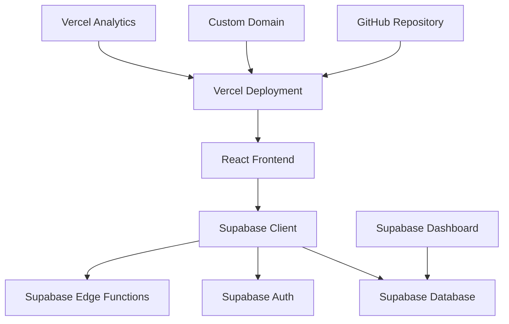

# 🚀 Deployment Guide - Supabase + Vercel Stack

Complete guide for deploying the Digital Textile Printing Management System using Supabase + Vercel.

## 📋 Overview

This guide covers:
- ✅ **Supabase Setup** - Database, Auth, and Edge Functions
- ✅ **Vercel Deployment** - Frontend hosting and CI/CD
- ✅ **Environment Configuration** - Production settings
- ✅ **Domain Setup** - Custom domain configuration
- ✅ **Monitoring & Maintenance** - Health checks and updates

## 🏗️ Architecture



## 🎯 Prerequisites

### **Required Accounts**
- ✅ **GitHub Account** (free)
- ✅ **Supabase Account** (free tier available)
- ✅ **Vercel Account** (free tier available)
- ✅ **Domain Name** (optional, for custom domain)

### **Required Tools**
- ✅ **Node.js 16+** and npm
- ✅ **Git** for version control
- ✅ **Supabase CLI** (`npx supabase` or official installer)
- ✅ **Vercel CLI** (`npm install -g vercel`)

## 📚 Table of Contents

1. [🗄️ Supabase Setup](#supabase-setup)
2. [🌐 Vercel Deployment](#vercel-deployment)
3. [🔐 Environment Configuration](#environment-configuration)
4. [🌍 Domain Configuration](#domain-configuration)
5. [📊 Monitoring Setup](#monitoring-setup)
6. [🔄 CI/CD Pipeline](#cicd-pipeline)
7. [🛠️ Maintenance](#maintenance)
8. [🚨 Troubleshooting](#troubleshooting)

---

## 🗄️ Supabase Setup

### **Step 1: Create Supabase Project**

1. **Go to Supabase Dashboard**
   ```
   Visit: https://supabase.com
   Click: "New Project"
   ```

2. **Project Configuration**
   ```
   Name: [YOUR-CUSTOM-PROJECT-NAME] (any name you prefer)
   Database Password: [Generate strong password]
   Region: [Choose closest to your users]
   Plan: Free (or Pro for production)
   ```
   
   > 💡 **Note**: Use any project name you want - the setup will adapt to your choices.

3. **Wait for Project Creation** (2-3 minutes)

### **Step 2: Database Schema Setup**

1. **Clone Repository**
   ```bash
   git clone https://github.com/yourusername/[YOUR-REPO-NAME].git
   cd [YOUR-PROJECT-FOLDER]
   ```

2. **Run Migration Setup**
   ```bash
   # Automated setup script
   python3 setup_supabase_migration.py
   ```

3. **Apply Schema to Remote Supabase**
   ```bash
   # Link to your Supabase project
   npx supabase link --project-ref [YOUR_PROJECT_ID]
   
   # Apply database schema to remote database
   npx supabase db push
   ```

### **Step 3: Configure Authentication**

1. **Enable Email Authentication**
   ```
   Supabase Dashboard → Authentication → Settings
   ✅ Enable email confirmation: No (for development)
   ✅ Enable email signup: No (admin-controlled)
   ```

2. **Set Site URL**
   ```
   Site URL: https://your-domain.vercel.app
   Redirect URLs: https://your-domain.vercel.app/**
   ```

3. **Create Admin User**
   ```sql
   -- Run in Supabase SQL Editor
   INSERT INTO auth.users (
     id,
     email,
     encrypted_password,
     email_confirmed_at,
     created_at,
     updated_at,
     role
   ) VALUES (
     gen_random_uuid(),
     'admin@yourdomain.com',
     crypt('YourSecurePassword123!', gen_salt('bf')),
     now(),
     now(),
     now(),
     'authenticated'
   );
   ```

### **Step 4: Edge Functions Setup**

1. **Deploy Edge Functions**
   ```bash
   # Deploy all edge functions to remote Supabase
   npx supabase functions deploy
   
   # Or deploy specific function
   npx supabase functions deploy orders
   ```

2. **Set Function Environment Variables**
   ```bash
   # Set secrets for edge functions
   npx supabase secrets set SUPABASE_SERVICE_ROLE_KEY=your_service_role_key
   ```

### **Step 5: Row Level Security (RLS)**

The schema automatically enables RLS. Verify policies:

```sql
-- Check RLS is enabled
SELECT schemaname, tablename, rowsecurity 
FROM pg_tables 
WHERE schemaname = 'public' AND rowsecurity = true;

-- Check policies
SELECT schemaname, tablename, policyname 
FROM pg_policies 
WHERE schemaname = 'public';
```

---

## 🌐 Vercel Deployment

### **Step 1: Prepare Repository**

1. **Push to GitHub**
   ```bash
   git add .
   git commit -m "feat: Supabase + Vercel migration"
   git push origin main
   ```

2. **Verify Frontend Structure**
   ```
   frontend/
   ├── package.json
   ├── next.config.js (if using Next.js)
   ├── src/
   └── public/
   ```

### **Step 2: Connect to Vercel**

1. **Visit Vercel Dashboard**
   ```
   https://vercel.com/dashboard
   Click: "Import Project"
   ```

2. **Import from GitHub**
   ```
   Select: Your repository
   Framework: React (auto-detected)
   Root Directory: frontend/
   ```

3. **Configure Build Settings**
   ```
   Build Command: npm run build
   Output Directory: build/ (or dist/)
   Install Command: npm install
   ```

### **Step 3: Environment Variables**

Add these environment variables in Vercel Dashboard:

```bash
# Required Environment Variables
NEXT_PUBLIC_SUPABASE_URL=https://your-project.supabase.co
NEXT_PUBLIC_SUPABASE_ANON_KEY=your_anon_key
NEXT_PUBLIC_APP_NAME=Digital Textile Printing System
NEXT_PUBLIC_APP_VERSION=3.0.0
NEXT_PUBLIC_ENVIRONMENT=production
```

**How to add in Vercel:**
```
Project Settings → Environment Variables → Add New
```

### **Step 4: Deploy**

1. **Initial Deployment**
   ```bash
   # Vercel will automatically deploy on push
   # Or deploy manually
   vercel --prod
   ```

2. **Verify Deployment**
   ```
   ✅ Build successful
   ✅ Functions deployed
   ✅ Environment variables set
   ✅ Site accessible
   ```

---

## 🔐 Environment Configuration

### **Development vs Production**

| Environment | Database | Authentication | Edge Functions |
|-------------|----------|---------------|----------------|
| **Development** | Remote Supabase | Remote auth | Remote functions |
| **Staging** | Supabase staging | Staging auth | Staging functions |
| **Production** | Same Supabase | Same auth | Same functions |

### **Environment Variables**

#### **Frontend (.env.local)**
```bash
# Supabase Configuration
NEXT_PUBLIC_SUPABASE_URL=https://your-project.supabase.co
NEXT_PUBLIC_SUPABASE_ANON_KEY=eyJhbGciOiJIUzI1NiIsInR5cCI6IkpXVCJ9...

# Application Configuration
NEXT_PUBLIC_APP_NAME=Digital Textile Printing System
NEXT_PUBLIC_APP_VERSION=3.0.0
NEXT_PUBLIC_ENVIRONMENT=production

# Analytics (Optional)
NEXT_PUBLIC_VERCEL_ANALYTICS_ID=your_analytics_id
```

#### **Supabase Edge Functions (.env)**
```bash
# Service Role Key (for server-side operations)
SUPABASE_SERVICE_ROLE_KEY=eyJhbGciOiJIUzI1NiIsInR5cCI6IkpXVCJ9...
SUPABASE_URL=https://your-project.supabase.co

# External API Keys (if needed)
SMTP_API_KEY=your_smtp_key
PAYMENT_GATEWAY_KEY=your_payment_key
```

### **Security Configuration**

1. **Supabase Security**
   ```sql
   -- Enable RLS on all tables
   ALTER TABLE customers ENABLE ROW LEVEL SECURITY;
   ALTER TABLE orders ENABLE ROW LEVEL SECURITY;
   -- (Applied automatically via schema)
   ```

2. **Vercel Security Headers**
   ```javascript
   // next.config.js
   module.exports = {
     async headers() {
       return [
         {
           source: '/(.*)',
           headers: [
             {
               key: 'X-Frame-Options',
               value: 'DENY'
             },
             {
               key: 'X-Content-Type-Options',
               value: 'nosniff'
             },
             {
               key: 'X-XSS-Protection',
               value: '1; mode=block'
             }
           ]
         }
       ]
     }
   }
   ```

---

## 🌍 Domain Configuration

### **Option 1: Vercel Subdomain (Free)**

Your app will be available at:
```
https://your-project-name.vercel.app
```

### **Option 2: Custom Domain**

1. **Add Domain in Vercel**
   ```
   Project Settings → Domains → Add Domain
   Enter: yourdomain.com
   ```

2. **Configure DNS**
   ```
   # For root domain (yourdomain.com)
   A Record: 76.76.19.61

   # For www subdomain
   CNAME Record: cname.vercel-dns.com
   ```

3. **SSL Certificate**
   ```
   ✅ Automatic SSL via Let's Encrypt
   ✅ HTTPS redirect enabled
   ✅ HSTS headers configured
   ```

### **Option 3: Subdomain Setup**

```
# For app.yourdomain.com
CNAME Record: cname.vercel-dns.com

# Update Supabase Auth settings
Site URL: https://app.yourdomain.com
Redirect URLs: https://app.yourdomain.com/**
```

---

## 📊 Monitoring Setup

### **Vercel Analytics**

1. **Enable Analytics**
   ```
   Project Settings → Analytics → Enable
   ```

2. **Add to Frontend**
   ```javascript
   // pages/_app.js (Next.js) or main.jsx (React)
   import { Analytics } from '@vercel/analytics/react'
   
   export default function App({ Component, pageProps }) {
     return (
       <>
         <Component {...pageProps} />
         <Analytics />
       </>
     )
   }
   ```

### **Supabase Monitoring**

1. **Database Monitoring**
   ```
   Supabase Dashboard → Settings → Database
   ✅ Connection pooling enabled
   ✅ Query performance insights
   ✅ Table optimization
   ```

2. **API Monitoring**
   ```
   Supabase Dashboard → Settings → API
   ✅ Rate limiting configured
   ✅ Request logs enabled
   ✅ Error tracking active
   ```

3. **Edge Function Monitoring**
   ```
   Supabase Dashboard → Edge Functions
   ✅ Function logs
   ✅ Performance metrics
   ✅ Error rates
   ```

### **Health Checks**

Create health check endpoints:

```typescript
// pages/api/health.ts (Next.js)
export default async function handler(req, res) {
  try {
    // Check Supabase connection
    const { data, error } = await supabase
      .from('users')
      .select('count')
      .limit(1)
    
    if (error) throw error
    
    res.status(200).json({
      status: 'healthy',
      timestamp: new Date().toISOString(),
      database: 'connected',
      version: process.env.NEXT_PUBLIC_APP_VERSION
    })
  } catch (error) {
    res.status(500).json({
      status: 'unhealthy',
      error: error.message
    })
  }
}
```

---

## 🔄 CI/CD Pipeline

### **Automatic Deployment**

Vercel automatically deploys when you push to GitHub:

```yaml
# .github/workflows/deploy.yml (optional - Vercel handles this)
name: Deploy to Vercel
on:
  push:
    branches: [main]
    
jobs:
  deploy:
    runs-on: ubuntu-latest
    steps:
      - uses: actions/checkout@v2
      - name: Deploy to Vercel
        uses: amondnet/vercel-action@v20
        with:
          vercel-token: ${{ secrets.VERCEL_TOKEN }}
          vercel-org-id: ${{ secrets.ORG_ID }}
          vercel-project-id: ${{ secrets.PROJECT_ID }}
```

### **Database Migrations**

```bash
# Create new migration
npx supabase migration new add_new_feature

# Apply migration to remote database
npx supabase db push --linked

# Verify migration
npx supabase db diff --linked
```

### **Edge Function Updates**

```bash
# Deploy updated function
npx supabase functions deploy function-name

# Verify deployment
npx supabase functions list
```

---

## 🛠️ Maintenance

### **Regular Updates**

1. **Weekly Tasks**
   ```bash
   # Update dependencies
   cd frontend && npm update
   
   # Check for security vulnerabilities
   npm audit
   
   # Update Supabase CLI (if using official installer)
   # curl -fsSL https://supabase.com/install.sh | sh
   ```

2. **Monthly Tasks**
   ```bash
   # Review database performance
   # Check error logs
   # Update documentation
   # Security review
   ```

### **Backup Strategy**

1. **Database Backups**
   ```bash
   # Automatic daily backups (Supabase Pro)
   # Point-in-time recovery available
   
   # Manual backup
   npx supabase db dump --data-only > backup.sql
   ```

2. **Code Backups**
   ```bash
   # Git repository serves as code backup
   # Multiple environments for rollback
   ```

### **Performance Optimization**

1. **Database Optimization**
   ```sql
   -- Add indexes for better performance
   CREATE INDEX idx_orders_customer_date 
   ON orders(customer_id, order_date);
   
   -- Analyze query performance
   EXPLAIN ANALYZE SELECT * FROM orders 
   WHERE customer_id = 'uuid';
   ```

2. **Frontend Optimization**
   ```javascript
   // Implement code splitting
   const CustomerPage = lazy(() => import('./CustomerPage'))
   
   // Optimize bundle size
   npm run build -- --analyze
   ```

---

## 🚨 Troubleshooting

### **Common Issues**

#### **1. Deployment Fails**
```bash
# Check build logs
vercel logs

# Common fixes:
# - Check environment variables
# - Verify build command
# - Check package.json scripts
```

#### **2. Database Connection Issues**
```bash
# Test connection
npx supabase db ping

# Check remote database connection
# Verify environment variables
# Check RLS policies
```

#### **3. Authentication Problems**
```javascript
// Debug auth issues
const { data: { session }, error } = await supabase.auth.getSession()
console.log('Session:', session, 'Error:', error)

// Common fixes:
// - Check Site URL in Supabase
// - Verify redirect URLs
// - Check CORS settings
```

#### **4. Edge Function Errors**
```bash
# Check function logs
npx supabase functions logs function-name

# Deploy with verbose logging
npx supabase functions deploy function-name --debug
```

### **Debug Commands**

```bash
# Check Vercel deployment status
vercel ls

# Check Supabase project status
npx supabase projects list

# Test edge function locally (connects to remote)
npx supabase functions serve

# Check database schema
npx supabase db diff
```

### **Performance Issues**

1. **Slow Database Queries**
   ```sql
   -- Enable query logging
   ALTER SYSTEM SET log_statement = 'all';
   
   -- Find slow queries
   SELECT query, mean_time 
   FROM pg_stat_statements 
   ORDER BY mean_time DESC;
   ```

2. **Frontend Performance**
   ```bash
   # Analyze bundle size
   npm run build -- --analyze
   
   # Check Core Web Vitals
   # Use Vercel Analytics
   # Implement lazy loading
   ```

---

## 📝 Deployment Checklist

### **Pre-Deployment**
- [ ] Code reviewed and tested
- [ ] Environment variables configured
- [ ] Database schema updated
- [ ] Edge functions tested
- [ ] Security policies reviewed

### **Deployment**
- [ ] Deploy to staging first
- [ ] Run smoke tests
- [ ] Deploy to production
- [ ] Verify all features work
- [ ] Check performance metrics

### **Post-Deployment**
- [ ] Monitor error rates
- [ ] Check user feedback
- [ ] Review performance
- [ ] Update documentation
- [ ] Celebrate! 🎉

---

## 🎯 Production Best Practices

### **Security**
- ✅ Enable Row Level Security (RLS)
- ✅ Use service role key only in edge functions
- ✅ Implement proper CORS policies
- ✅ Regular security audits
- ✅ Keep dependencies updated

### **Performance**
- ✅ Enable database connection pooling
- ✅ Use database indexes appropriately
- ✅ Implement caching strategies
- ✅ Optimize frontend bundle size
- ✅ Use CDN for static assets

### **Reliability**
- ✅ Set up monitoring and alerts
- ✅ Implement health checks
- ✅ Use multiple environments
- ✅ Regular backups
- ✅ Documentation up to date

---

## 🎉 Success!

Your Digital Textile Printing Management System is now deployed and ready for production use!

### **What's Next?**
1. **Set up monitoring** - Configure alerts and dashboards
2. **User training** - Train your team on the new system
3. **Data migration** - Import existing data if needed
4. **Customize** - Add business-specific features
5. **Scale** - Monitor usage and scale as needed

### **Support Resources**
- **Documentation**: [Complete guides](../README.md)
- **Community**: [Discord channel](https://discord.gg/textile-printing)
- **Issues**: [GitHub Issues](https://github.com/yourusername/[YOUR-REPO-NAME]/issues)

**Happy deploying! 🚀**