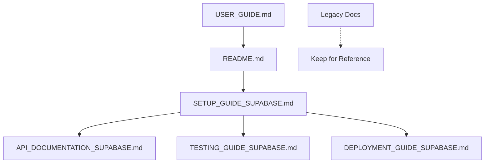

# 📚 Documentation Guide

Complete documentation directory for the Digital Textile Printing Management System.

## 🎯 **Quick Navigation**

### **🚀 For New Users (Start Here!)**
1. **[SETUP_GUIDE_SUPABASE.md](SETUP_GUIDE_SUPABASE.md)** - Environment setup and installation
2. **[DEPLOYMENT_GUIDE_SUPABASE.md](DEPLOYMENT_GUIDE_SUPABASE.md)** - Production deployment
3. **[USER_GUIDE.md](USER_GUIDE.md)** - How to use the system

### **🔧 For Developers**
4. **[API_DOCUMENTATION_SUPABASE.md](API_DOCUMENTATION_SUPABASE.md)** - Complete API reference
5. **[TESTING_GUIDE_SUPABASE.md](TESTING_GUIDE_SUPABASE.md)** - Testing strategies and examples

## 📋 **Documentation Status**

### ✅ **Current (Supabase + Vercel Stack)**
| Document | Purpose | Priority | Status |
|----------|---------|----------|---------|
| **SETUP_GUIDE_SUPABASE.md** | Environment setup | 🔥 High | ✅ Updated |
| **DEPLOYMENT_GUIDE_SUPABASE.md** | Production deployment | 🔥 High | ✅ Updated |
| **API_DOCUMENTATION_SUPABASE.md** | API reference | 📊 Medium | ✅ Updated |
| **TESTING_GUIDE_SUPABASE.md** | Testing guide | 📊 Medium | ✅ Updated |
| **USER_GUIDE.md** | End user guide | 👥 Low | ✅ Current |

### ⚠️ **Legacy (FastAPI + Render Stack)**
| Document | Purpose | Status | Action |
|----------|---------|---------|---------|
| **DEPLOYMENT_GUIDE.md** | Old deployment | 🗄️ Legacy | Keep for reference |
| **API_DOCUMENTATION.md** | Old API docs | 🗄️ Legacy | Keep for reference |
| **TESTING_GUIDE.md** | Old testing | 🗄️ Legacy | Keep for reference |

## 🔄 **Recommended Reading Order**

### **👨‍💼 For Business Owners/Managers**
```
1. README.md (main project overview)
2. USER_GUIDE.md (how to use the system)
3. DEPLOYMENT_GUIDE_SUPABASE.md (getting it live)
```

### **👨‍💻 For Developers**
```
1. SETUP_GUIDE_SUPABASE.md (development setup)
2. API_DOCUMENTATION_SUPABASE.md (API reference)
3. TESTING_GUIDE_SUPABASE.md (testing strategies)
4. DEPLOYMENT_GUIDE_SUPABASE.md (production setup)
```

### **🎓 For New Team Members**
```
1. README.md (project overview)
2. SETUP_GUIDE_SUPABASE.md (environment setup)
3. USER_GUIDE.md (how to use the system)
4. API_DOCUMENTATION_SUPABASE.md (technical details)
```

## 🗂️ **Document Descriptions**

### **🔧 SETUP_GUIDE_SUPABASE.md**
- **Purpose**: Complete development environment setup
- **Includes**: Prerequisites, installation, configuration
- **When to use**: First time setting up the project
- **Time needed**: 30-60 minutes

### **🚀 DEPLOYMENT_GUIDE_SUPABASE.md**
- **Purpose**: Production deployment to Supabase + Vercel
- **Includes**: Supabase setup, Vercel deployment, domain config
- **When to use**: Deploying to production
- **Time needed**: 45-90 minutes

### **📖 API_DOCUMENTATION_SUPABASE.md**
- **Purpose**: Complete API reference for developers
- **Includes**: Endpoints, examples, authentication, real-time
- **When to use**: Building integrations or customizations
- **Time needed**: Reference document (browse as needed)

### **🧪 TESTING_GUIDE_SUPABASE.md**
- **Purpose**: Testing strategies for the Supabase stack
- **Includes**: Unit tests, integration tests, E2E tests
- **When to use**: Setting up automated testing
- **Time needed**: 2-4 hours (initial setup)

### **👥 USER_GUIDE.md**
- **Purpose**: End-user documentation for the application
- **Includes**: Feature walkthroughs, business workflows
- **When to use**: Training users or understanding features
- **Time needed**: 1-2 hours

## 🎯 **Quick Start Scenarios**

### **Scenario 1: "I want to try the system locally"**
```
1. Read: SETUP_GUIDE_SUPABASE.md
2. Run: python3 setup_supabase_migration.py
3. Start: npm run dev
```

### **Scenario 2: "I want to deploy to production"**
```
1. Complete: Local setup first
2. Read: DEPLOYMENT_GUIDE_SUPABASE.md
3. Deploy: Follow deployment steps
```

### **Scenario 3: "I want to understand the API"**
```
1. Read: API_DOCUMENTATION_SUPABASE.md
2. Test: Use provided examples
3. Build: Custom integrations
```

### **Scenario 4: "I want to customize features"**
```
1. Setup: Local development environment
2. Read: API_DOCUMENTATION_SUPABASE.md
3. Test: TESTING_GUIDE_SUPABASE.md
4. Deploy: DEPLOYMENT_GUIDE_SUPABASE.md
```

## 🔍 **Document Dependencies**



## 📝 **Document Maintenance**

### **✅ When to Update**
- **SETUP_GUIDE_SUPABASE.md**: When adding new dependencies or tools
- **DEPLOYMENT_GUIDE_SUPABASE.md**: When deployment process changes
- **API_DOCUMENTATION_SUPABASE.md**: When adding/changing API endpoints
- **TESTING_GUIDE_SUPABASE.md**: When adding new testing strategies
- **USER_GUIDE.md**: When adding new features or UI changes

### **🗄️ Legacy Documents**
These documents are kept for reference but are **not recommended** for new projects:
- `DEPLOYMENT_GUIDE.md` (FastAPI + Render)
- `API_DOCUMENTATION.md` (FastAPI endpoints)
- `TESTING_GUIDE.md` (FastAPI testing)

> ⚠️ **Important**: Always use the `_SUPABASE.md` versions for the current stack!

## 🎉 **Getting Started Checklist**

### **For Your First Time:**
- [ ] Read this README.md
- [ ] Follow SETUP_GUIDE_SUPABASE.md
- [ ] Test with USER_GUIDE.md workflows
- [ ] Deploy using DEPLOYMENT_GUIDE_SUPABASE.md

### **For Development:**
- [ ] Environment setup complete
- [ ] API documentation bookmarked
- [ ] Testing environment configured
- [ ] Local deployment working

### **For Production:**
- [ ] Supabase project created
- [ ] Vercel deployment successful
- [ ] Domain configured (optional)
- [ ] Monitoring enabled

## 📞 **Getting Help**

- **Setup Issues**: Check SETUP_GUIDE_SUPABASE.md troubleshooting
- **Deployment Problems**: See DEPLOYMENT_GUIDE_SUPABASE.md troubleshooting
- **API Questions**: Browse API_DOCUMENTATION_SUPABASE.md examples
- **Feature Questions**: Check USER_GUIDE.md workflows

**Happy building! 🚀**