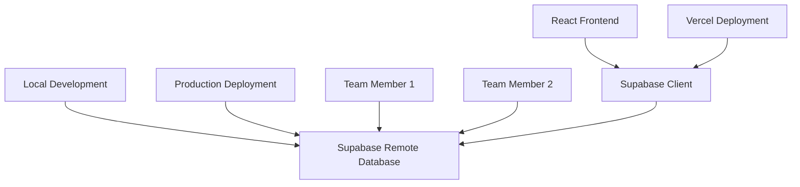

# 🌐 Setup Guide - Remote Supabase Database

Complete setup guide using **remote Supabase database** for both development and production (no local database required).

## 📋 Overview

This approach uses:
- ✅ **One Supabase Database** - Same database for development and production
- ✅ **No Local Database** - No PostgreSQL installation needed
- ✅ **Simple Setup** - Fewer moving parts
- ✅ **Cost Effective** - Free tier covers development and small production usage
- ✅ **Real-time Sync** - All team members use same data

## 🏗️ Architecture



## 🎯 Prerequisites

- Node.js 16+ and npm
- Supabase account (free)
- Vercel account (free)
- **No local PostgreSQL needed!** ✅

## 🚀 Step 1: Create Supabase Project

1. **Go to Supabase Dashboard**
   ```
   Visit: https://supabase.com
   Click: "New Project"
   ```

2. **Project Configuration**
   ```
   Name: [YOUR-PROJECT-NAME] (e.g., my-textile-business)
   Database Password: [Generate strong password - SAVE THIS!]
   Region: [Choose closest to your location]
   Plan: Free (perfect for development + small production)
   ```

3. **Wait for Creation** (2-3 minutes)

4. **Get Project Details**
   ```
   Go to: Settings → API
   Copy and save:
   - Project URL: https://xxx.supabase.co
   - Anon/Public Key: eyJhbGci...
   - Service Role Key: eyJhbGci... (keep secret!)
   ```

## 🗄️ Step 2: Setup Database Schema

### **Option A: Automated Setup (Recommended)**

1. **Clone Repository**
   ```bash
   git clone https://github.com/yourusername/[YOUR-REPO-NAME].git
   cd [YOUR-PROJECT-FOLDER]
   ```

2. **Run Migration Script**
   ```bash
   python3 setup_supabase_migration.py
   ```
   
   When prompted:
   - Choose **"Production"** environment
   - Enter your Supabase project details
   - The script will apply the schema to your remote database

### **Option B: Manual Setup**

1. **Apply Schema via Dashboard**
   ```
   1. Go to Supabase Dashboard → SQL Editor
   2. Copy content from: supabase/schema.sql
   3. Paste and run the SQL
   ```

2. **Verify Tables Created**
   ```
   Go to: Database → Tables
   You should see: users, customers, orders, etc.
   ```

## 🔐 Step 3: Environment Configuration

### **Development Environment** (`frontend/.env.local`)

```bash
# Supabase Configuration (same for dev and prod)
NEXT_PUBLIC_SUPABASE_URL=https://your-project.supabase.co
NEXT_PUBLIC_SUPABASE_ANON_KEY=your_anon_key

# Application Configuration
NEXT_PUBLIC_APP_NAME=Digital Textile Printing System
NEXT_PUBLIC_APP_VERSION=3.0.0
NEXT_PUBLIC_ENVIRONMENT=development

# Note: Same database URL for development and production!
```

### **Production Environment** (Vercel Dashboard)

```bash
# Same values as development
NEXT_PUBLIC_SUPABASE_URL=https://your-project.supabase.co
NEXT_PUBLIC_SUPABASE_ANON_KEY=your_anon_key
NEXT_PUBLIC_ENVIRONMENT=production
```

## 💻 Step 4: Local Development Setup

1. **Install Dependencies**
   ```bash
   cd frontend
   npm install
   ```

2. **Start Development Server**
   ```bash
   npm run dev
   ```

3. **Your app runs at:** http://localhost:3000
   - Uses remote Supabase database
   - No local database needed
   - Real-time updates work automatically

## 🚀 Step 5: Production Deployment

### **Deploy to Vercel**

1. **Connect Repository to Vercel**
   ```
   1. Go to vercel.com
   2. Import your GitHub repository
   3. Set framework: React
   4. Set root directory: frontend/
   ```

2. **Configure Environment Variables**
   ```
   In Vercel Dashboard → Settings → Environment Variables:
   
   NEXT_PUBLIC_SUPABASE_URL=https://your-project.supabase.co
   NEXT_PUBLIC_SUPABASE_ANON_KEY=your_anon_key
   NEXT_PUBLIC_ENVIRONMENT=production
   ```

3. **Deploy**
   ```bash
   # Automatic deployment on git push
   git push origin main
   
   # Or manual deployment
   npx vercel --prod
   ```

## 🔧 Step 6: Authentication Setup

1. **Configure Auth in Supabase**
   ```
   Go to: Authentication → Settings
   
   Site URL: https://your-domain.vercel.app
   Redirect URLs: https://your-domain.vercel.app/**
   
   Disable email confirmations (for development)
   Disable public signups (admin-controlled)
   ```

2. **Create Admin User**
   ```sql
   -- Run in Supabase SQL Editor
   INSERT INTO auth.users (
     id,
     email,
     encrypted_password,
     email_confirmed_at,
     created_at,
     updated_at,
     role
   ) VALUES (
     gen_random_uuid(),
     'admin@yourdomain.com',
     crypt('YourPassword123!', gen_salt('bf')),
     now(),
     now(),
     now(),
     'authenticated'
   );
   
   -- Create user profile
   INSERT INTO public.users (
     id,
     username,
     email,
     full_name,
     role
   ) VALUES (
     (SELECT id FROM auth.users WHERE email = 'admin@yourdomain.com'),
     'admin',
     'admin@yourdomain.com',
     'System Administrator',
     'admin'
   );
   ```

## 📊 Step 7: Verify Setup

### **Test Database Connection**

```javascript
// Test in browser console
const { data, error } = await supabase.from('customers').select('count')
console.log('Database connection:', { data, error })
```

### **Test Authentication**

```javascript
// Test login
const { data, error } = await supabase.auth.signInWithPassword({
  email: 'admin@yourdomain.com',
  password: 'YourPassword123!'
})
console.log('Auth test:', { data, error })
```

## 🎯 Benefits of This Approach

### ✅ **Advantages**

- **Simpler Setup** - No local database installation
- **Team Collaboration** - Everyone uses same data
- **Real-time Sync** - Changes visible to all team members
- **Cost Effective** - One database for everything
- **Easy Backup** - Automatic backups by Supabase
- **Production-like Development** - Same environment everywhere

### ⚠️ **Considerations**

- **Shared Data** - Team members see each other's test data
- **No Offline Development** - Requires internet connection
- **Rate Limits** - Free tier has usage limits (generous for small teams)

## 🔄 Development Workflow

### **Daily Development**
```bash
# 1. Pull latest code
git pull origin main

# 2. Start development
cd frontend
npm run dev

# 3. Make changes (uses remote database)
# 4. Test features
# 5. Commit and push
git add .
git commit -m "feature: add new functionality"
git push origin main

# 6. Vercel automatically deploys to production
```

### **Database Changes**
```bash
# 1. Update schema in supabase/schema.sql
# 2. Apply changes in Supabase Dashboard
# 3. Test in development
# 4. Changes automatically available in production
```

## 🚨 Troubleshooting

### **Connection Issues**
```javascript
// Check environment variables
console.log('Supabase URL:', process.env.NEXT_PUBLIC_SUPABASE_URL)
console.log('Anon Key:', process.env.NEXT_PUBLIC_SUPABASE_ANON_KEY?.slice(0, 20) + '...')

// Test connection
const { data, error } = await supabase.from('users').select('count')
if (error) console.error('Connection error:', error)
else console.log('Connection successful:', data)
```

### **Authentication Issues**
```javascript
// Check current session
const { data: { session } } = await supabase.auth.getSession()
console.log('Current session:', session)

// Check RLS policies
const { data, error } = await supabase.from('customers').select('*').limit(1)
console.log('RLS test:', { data, error })
```

### **Environment Variable Issues**
```bash
# Check if .env.local exists
ls -la frontend/.env.local

# Restart development server after changing env vars
npm run dev
```

## 📝 Data Management

### **Development Data**
- Use test customers with obvious test names
- Prefix test data with "TEST_" or "DEV_"
- Regularly clean up test data

### **Production Data**
- Real customer data
- Regular backups via Supabase dashboard
- Monitor usage in Supabase dashboard

### **Team Coordination**
- Communicate when making schema changes
- Use meaningful commit messages
- Test features thoroughly before pushing

## 🎉 Success Checklist

- [ ] Supabase project created
- [ ] Database schema applied
- [ ] Environment variables configured
- [ ] Local development working
- [ ] Production deployment successful
- [ ] Authentication working
- [ ] Team members can access
- [ ] Backup strategy understood

## 📞 Support

- **Supabase Issues**: [Supabase Documentation](https://supabase.com/docs)
- **Vercel Issues**: [Vercel Documentation](https://vercel.com/docs)
- **Project Issues**: [GitHub Issues](https://github.com/yourusername/[YOUR-REPO-NAME]/issues)

**You're now ready to develop with a single remote database! 🚀**