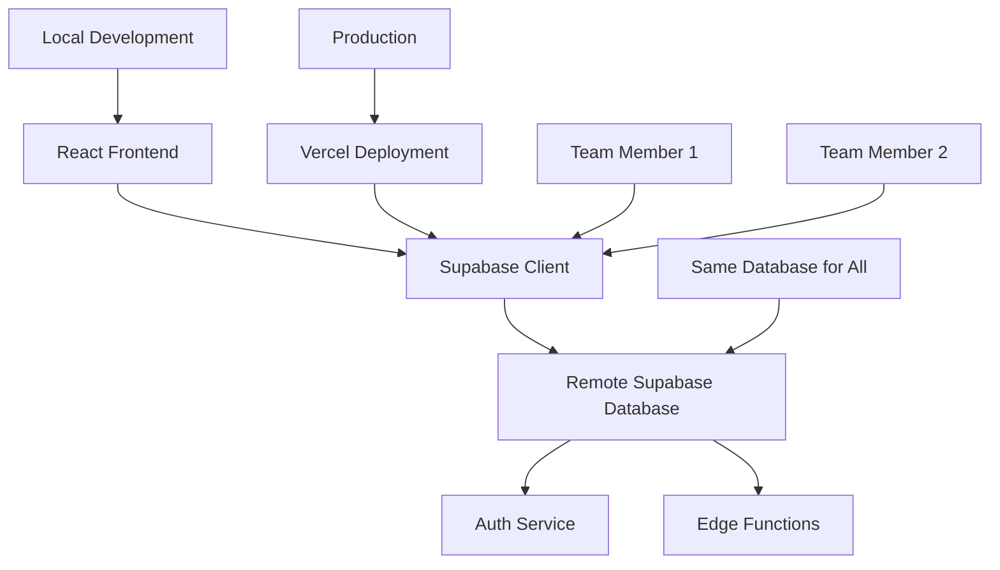

# 🔧 Setup Guide - Supabase + Vercel Stack

Complete environment setup guide for the Digital Textile Printing Management System.

## 📋 Overview

This guide provides step-by-step instructions for setting up your development environment for the **Supabase + Vercel** stack.

### **What You'll Have After Setup**
- ✅ **Remote Database Setup** with Supabase and React
- ✅ **Database Schema** with all tables and relationships
- ✅ **Authentication System** with user roles and permissions
- ✅ **Real-time Features** with live data updates
- ✅ **Production-Ready Deployment** on Vercel
- ✅ **Single Database** for development and production

## 🏗️ Architecture Overview



## 📚 Table of Contents

1. [⚡ Quick Start](#quick-start)
2. [🛠️ Prerequisites](#prerequisites)
3. [🗄️ Supabase Setup](#supabase-setup)
4. [💻 Local Development](#local-development)
5. [🌐 Frontend Setup](#frontend-setup)
6. [⚡ Edge Functions](#edge-functions)
7. [🔐 Authentication Setup](#authentication-setup)
8. [📊 Data Seeding](#data-seeding)
9. [🚀 Production Setup](#production-setup)
10. [🔧 IDE Configuration](#ide-configuration)
11. [🚨 Troubleshooting](#troubleshooting)

---

## ⚡ Quick Start

### **5-Minute Setup** (For the impatient!)

```bash
# 1. Install prerequisites
npm install -g supabase vercel

# 2. Clone and setup
git clone <your-repo-url>
cd [YOUR-PROJECT-FOLDER]

# 3. Run automated setup
python3 setup_supabase_migration.py

# 4. Start development
cd frontend && npm install && npm run dev
```

**Your app will be running at:** http://localhost:3000

---

## 🛠️ Prerequisites

### **System Requirements**

| Tool | Version | Purpose |
|------|---------|---------|
| **Node.js** | 16+ | JavaScript runtime |
| **npm** | 8+ | Package manager |
| **Python** | 3.9+ | Setup scripts |
| **Git** | Latest | Version control |
| **Docker** | Latest | Local Supabase (optional) |

### **Required Accounts**

1. **GitHub Account** (free)
   - For code hosting and version control
   - Sign up: https://github.com

2. **Supabase Account** (free tier available)
   - For database and backend services
   - Sign up: https://supabase.com

3. **Vercel Account** (free tier available)
   - For frontend deployment
   - Sign up: https://vercel.com

### **Installation Commands**

#### **Windows**
```powershell
# Install Node.js
winget install OpenJS.NodeJS

# Install Git
winget install Git.Git

# Install Python
winget install Python.Python.3.9

# Install Docker (optional)
winget install Docker.DockerDesktop
```

#### **macOS**
```bash
# Install Homebrew (if not installed)
/bin/bash -c "$(curl -fsSL https://raw.githubusercontent.com/Homebrew/install/HEAD/install.sh)"

# Install prerequisites
brew install node python@3.9 git
brew install --cask docker  # Optional
```

#### **Ubuntu/Debian**
```bash
# Update package list
sudo apt update

# Install Node.js
curl -fsSL https://deb.nodesource.com/setup_18.x | sudo -E bash -
sudo apt-get install -y nodejs

# Install Python
sudo apt install python3.9 python3-pip

# Install Git
sudo apt install git

# Install Docker (optional)
sudo apt install docker.io
```

### **Global Tools Installation**

```bash
# Install Supabase CLI (use npx or official installer)
# Option 1: Use npx (no installation needed)
npx supabase --version

# Option 2: Official installer (Linux/macOS)
# curl -fsSL https://supabase.com/install.sh | sh

# Install Vercel CLI
npm install -g vercel

# Verify installations
node --version    # Should be 16+
npm --version     # Should be 8+
npx supabase --version  # or supabase --version if using official installer
vercel --version
```

---

## 🗄️ Supabase Setup

### **Remote Supabase Database (Single Database Approach)**

> 💡 **Single Database for Everything**: Use one remote Supabase database for both development and production. No local database installation needed!

1. **Create Supabase Project**
   ```
   1. Visit: https://supabase.com
   2. Click "New Project"
   3. Fill details:
      - Name: [YOUR-CUSTOM-PROJECT-NAME] (any name you prefer)
      - Database Password: [Generate strong password - SAVE THIS!]
      - Region: [Choose closest to your location]
      - Plan: Free (perfect for development + small production)
   4. Wait for project creation (2-3 minutes)
   ```

2. **Get Project Credentials**
   ```
   1. Go to Settings → API
   2. Copy and save:
      - Project URL: https://xxx.supabase.co
      - Anon/Public Key: eyJhbGci...
      - Service Role Key: eyJhbGci... (keep secret!)
   ```

> ✅ **Benefits**: No local setup, team collaboration, real-time sync, same database for dev & production!

### **Database Schema Setup**

1. **Run Migration Script** (Recommended)
   ```bash
   # Automated setup with our script
   python3 setup_supabase_migration.py
   
   # When prompted:
   # - Choose "Production" environment
   # - Enter your Supabase project details
   # - Script will apply schema to your remote database
   ```

2. **Manual Schema Setup** (Alternative)
   ```bash
   # Option A: Via Supabase Dashboard
   # 1. Go to Supabase Dashboard → SQL Editor
   # 2. Copy content from: supabase/schema.sql
   # 3. Paste and run the SQL
   
   # Option B: Via CLI
   # npx supabase db push (applies schema to remote database)
   ```

3. **Verify Schema**
   ```bash
   # View in Supabase Dashboard
   # Go to: Database → Tables
   # You should see: users, customers, orders, etc.
   ```

---

## 💻 Local Development

### **Project Structure Setup**

```bash
# Clone repository
git clone https://github.com/yourusername/[YOUR-REPO-NAME].git
cd [YOUR-PROJECT-FOLDER]

# Project structure after setup:
[YOUR-PROJECT-FOLDER]/
├── frontend/                 # React application
├── supabase/                # Database and backend
├── docs/                    # Documentation
├── backup_fastapi/         # Previous backend (backup)
└── setup_supabase_migration.py
```

### **Environment Configuration**

1. **Frontend Environment** (`frontend/.env.local`)
   ```bash
   # Supabase Configuration (Remote Database)
   NEXT_PUBLIC_SUPABASE_URL=https://your-project.supabase.co
   NEXT_PUBLIC_SUPABASE_ANON_KEY=your_remote_anon_key
   
   # Application Configuration
   NEXT_PUBLIC_APP_NAME=Digital Textile Printing System
   NEXT_PUBLIC_APP_VERSION=3.0.0
   NEXT_PUBLIC_ENVIRONMENT=development
   
   # Note: Same database URL for development and production!
   ```

2. **Edge Functions Configuration** (`supabase/.env`)
   ```bash
   # Service Role Key (for edge functions)
   SUPABASE_SERVICE_ROLE_KEY=your_service_role_key
   SUPABASE_URL=https://your-project.supabase.co
   ```

### **Development Workflow**

```bash
# No local database setup needed!
# Just start the frontend:

cd frontend
npm install
npm run dev

# Your app will be running at:
# Frontend: http://localhost:3000 (connects to remote Supabase)
# Supabase Dashboard: https://app.supabase.com (manage your database)

# Same database for development and production!
```

---

## 🌐 Frontend Setup

### **React App Configuration**

1. **Install Dependencies**
   ```bash
   cd frontend
   npm install
   ```

2. **Key Dependencies** (already in package.json)
   ```json
   {
     "dependencies": {
       "@supabase/supabase-js": "^2.x",
       "react": "^18.x",
       "react-dom": "^18.x",
       "@mui/material": "^5.x",
       "react-router-dom": "^6.x"
     }
   }
   ```

3. **Supabase Client Setup** (`lib/supabase.js`)
   ```javascript
   import { createClient } from '@supabase/supabase-js'
   
   const supabaseUrl = process.env.NEXT_PUBLIC_SUPABASE_URL
   const supabaseAnonKey = process.env.NEXT_PUBLIC_SUPABASE_ANON_KEY
   
   export const supabase = createClient(supabaseUrl, supabaseAnonKey)
   ```

4. **Start Development Server**
   ```bash
   npm run dev
   # or
   npm start
   ```

### **Frontend Development Commands**

```bash
# Development
npm run dev          # Start development server
npm run build        # Build for production
npm run preview      # Preview production build

# Testing
npm run test         # Run unit tests
npm run test:e2e     # Run end-to-end tests

# Code Quality
npm run lint         # Run ESLint
npm run type-check   # TypeScript type checking
```

---

## ⚡ Edge Functions

### **Setup Edge Functions**

1. **Function Structure**
   ```
   supabase/functions/
   ├── orders/
   │   └── index.ts
   ├── reports/
   │   └── index.ts
   └── _shared/
       └── cors.ts
   ```

2. **Deploy Functions Locally**
   ```bash
   # Serve all functions
   supabase functions serve
   
   # Serve specific function
   supabase functions serve orders
   ```

3. **Deploy to Production**
   ```bash
   # Deploy all functions
   supabase functions deploy
   
   # Deploy specific function
   supabase functions deploy orders
   ```

### **Function Environment Variables**

```bash
# Set secrets for edge functions
supabase secrets set SUPABASE_SERVICE_ROLE_KEY=your_key
supabase secrets set SMTP_API_KEY=your_smtp_key

# List secrets
supabase secrets list
```

### **Test Edge Functions**

```bash
# Test locally
curl -X POST http://localhost:54321/functions/v1/orders \
  -H "Authorization: Bearer $SUPABASE_ANON_KEY" \
  -H "Content-Type: application/json" \
  -d '{"customer_id": "test-id", "items": []}'
```

---

## 🔐 Authentication Setup

### **Configure Auth Settings**

1. **In Supabase Studio**
   ```
   Authentication → Settings:
   ✅ Site URL: http://localhost:3000
   ✅ Redirect URLs: http://localhost:3000/**
   ❌ Enable email confirmations: No (for development)
   ❌ Enable signups: No (admin-controlled)
   ```

2. **Create Admin User**
   ```sql
   -- Run in SQL Editor
   INSERT INTO auth.users (
     id,
     email,
     encrypted_password,
     email_confirmed_at,
     created_at,
     updated_at,
     role
   ) VALUES (
     gen_random_uuid(),
     'admin@example.com',
     crypt('Admin@123!', gen_salt('bf')),
     now(),
     now(),
     now(),
     'authenticated'
   );
   
   -- Also create user profile
   INSERT INTO public.users (
     id,
     username,
     email,
     full_name,
     role
   ) VALUES (
     (SELECT id FROM auth.users WHERE email = 'admin@example.com'),
     'admin',
     'admin@example.com',
     'System Administrator',
     'admin'
   );
   ```

### **Test Authentication**

```javascript
// Test login in browser console
const { data, error } = await supabase.auth.signInWithPassword({
  email: 'admin@example.com',
  password: 'Admin@123!'
})

console.log('Auth result:', { data, error })
```

---

## 📊 Data Seeding

### **Sample Data Setup**

1. **Create Sample Customers**
   ```sql
   INSERT INTO customers (name, phone, email, address) VALUES
   ('ABC Textiles', '9876543210', 'abc@textiles.com', '123 Market Street'),
   ('XYZ Fabrics', '9876543211', 'xyz@fabrics.com', '456 Commerce Road'),
   ('Fashion House', '9876543212', 'contact@fashionhouse.com', '789 Style Avenue');
   ```

2. **Create Sample Orders**
   ```sql
   INSERT INTO orders (order_number, customer_id, status, total_amount) VALUES
   ('ORD-2025-0001', (SELECT id FROM customers WHERE name = 'ABC Textiles'), 'pending', 5000.00),
   ('ORD-2025-0002', (SELECT id FROM customers WHERE name = 'XYZ Fabrics'), 'in_progress', 3000.00);
   ```

3. **Run Seed Script**
   ```bash
   # If you have a seed script
   supabase db seed
   ```

### **Development Data Reset**

```bash
# Reset local database to clean state
supabase db reset

# Reapply migrations and seed data
supabase db push
```

---

## 🚀 Production Setup

### **Environment Variables for Production**

1. **Vercel Environment Variables**
   ```bash
   # Set in Vercel Dashboard or CLI
   NEXT_PUBLIC_SUPABASE_URL=https://your-project.supabase.co
   NEXT_PUBLIC_SUPABASE_ANON_KEY=your_production_anon_key
   NEXT_PUBLIC_ENVIRONMENT=production
   ```

2. **Supabase Production Settings**
   ```
   Settings → API:
   ✅ Site URL: https://your-domain.vercel.app
   ✅ Redirect URLs: https://your-domain.vercel.app/**
   ✅ Enable email confirmations: Yes
   ❌ Enable signups: No (keep admin-controlled)
   ```

### **Deploy to Production**

```bash
# Deploy frontend to Vercel
vercel --prod

# Deploy edge functions to Supabase
supabase functions deploy

# Apply database migrations
supabase db push --linked
```

---

## 🔧 IDE Configuration

### **VS Code Setup**

1. **Recommended Extensions**
   ```json
   // .vscode/extensions.json
   {
     "recommendations": [
       "bradlc.vscode-tailwindcss",
       "ms-typescript.vscode-typescript-next",
       "esbenp.prettier-vscode",
       "ms-vscode.vscode-eslint",
       "supabase.supabase",
       "ms-vscode.vscode-json"
     ]
   }
   ```

2. **Workspace Settings**
   ```json
   // .vscode/settings.json
   {
     "typescript.preferences.includePackageJsonAutoImports": "auto",
     "typescript.suggest.autoImports": true,
     "editor.formatOnSave": true,
     "editor.defaultFormatter": "esbenp.prettier-vscode",
     "editor.codeActionsOnSave": {
       "source.eslint.fixAll": true
     }
   }
   ```

3. **Debug Configuration**
   ```json
   // .vscode/launch.json
   {
     "version": "0.2.0",
     "configurations": [
       {
         "name": "Debug Frontend",
         "type": "node",
         "request": "launch",
         "program": "${workspaceFolder}/frontend/node_modules/.bin/react-scripts",
         "args": ["start"],
         "env": {
           "NODE_ENV": "development"
         },
         "cwd": "${workspaceFolder}/frontend"
       }
     ]
   }
   ```

### **Code Snippets**

```json
// .vscode/snippets.json
{
  "Supabase Query": {
    "prefix": "sbquery",
    "body": [
      "const { data, error } = await supabase",
      "  .from('${1:table}')",
      "  .select('${2:*}')",
      "  ${3:.eq('id', id)}",
      "",
      "if (error) {",
      "  console.error('Error:', error)",
      "  return",
      "}",
      "",
      "console.log('Data:', data)"
    ]
  }
}
```

---

## 🚨 Troubleshooting

### **Common Issues**

#### **1. Supabase Connection Issues**
```bash
# Problem: Cannot connect to Supabase
# Solution: Check if Supabase is running
supabase status

# If not running:
supabase start

# Check logs:
supabase logs
```

#### **2. Environment Variables Not Loading**
```bash
# Problem: Environment variables undefined
# Solution: Check file location and naming
ls -la frontend/.env.local

# Restart development server:
cd frontend && npm run dev
```

#### **3. Database Schema Issues**
```bash
# Problem: Tables don't exist
# Solution: Apply migrations
supabase db reset
supabase db push

# Check schema status:
supabase db diff
```

#### **4. Authentication Errors**
```javascript
// Problem: Cannot login
// Solution: Check auth configuration
const { data: { session } } = await supabase.auth.getSession()
console.log('Current session:', session)

// Verify user exists:
const { data: users } = await supabase.from('users').select('*')
console.log('Users:', users)
```

#### **5. Frontend Build Errors**
```bash
# Problem: Build fails
# Solution: Clear cache and reinstall
rm -rf node_modules package-lock.json
npm install

# Check for type errors:
npm run type-check
```

### **Debug Commands**

```bash
# Check all services status
supabase status

# View Supabase logs
supabase logs

# Test database connection
supabase db ping

# Check migrations status
supabase migration list

# View edge function logs
supabase functions logs function-name

# Test frontend build
cd frontend && npm run build
```

### **Performance Issues**

1. **Slow Database Queries**
   ```sql
   -- Enable query logging
   ALTER SYSTEM SET log_statement = 'all';
   
   -- Check slow queries
   SELECT query, mean_time, calls 
   FROM pg_stat_statements 
   ORDER BY mean_time DESC 
   LIMIT 10;
   ```

2. **Frontend Performance**
   ```bash
   # Analyze bundle size
   cd frontend && npm run build -- --analyze
   
   # Check for large dependencies
   npx webpack-bundle-analyzer build/static/js/*.js
   ```

### **Getting Help**

1. **Check Documentation**
   - [Supabase Docs](https://supabase.com/docs)
   - [React Docs](https://react.dev/)
   - [Vercel Docs](https://vercel.com/docs)

2. **Community Support**
   - [Supabase Discord](https://discord.supabase.com)
   - [Stack Overflow](https://stackoverflow.com/questions/tagged/supabase)

3. **Project Issues**
   - [GitHub Issues](https://github.com/yourusername/[YOUR-REPO-NAME]/issues)

---

## ✅ Setup Verification

### **Checklist**

- [ ] Node.js 16+ installed
- [ ] Supabase CLI working (npx supabase)
- [ ] Remote Supabase project created
- [ ] Database schema applied to remote database
- [ ] Frontend running on localhost:3000
- [ ] Can login with admin credentials
- [ ] Sample data visible
- [ ] Environment variables configured
- [ ] Remote database connection working

### **Test Commands**

```bash
# Test Node.js
node --version

# Test Supabase
supabase --version
supabase status

# Test Frontend
cd frontend && npm run build

# Test Database
curl http://localhost:54321/rest/v1/customers \
  -H "apikey: $SUPABASE_ANON_KEY"

# Test Authentication
curl -X POST http://localhost:54321/auth/v1/token \
  -H "apikey: $SUPABASE_ANON_KEY" \
  -H "Content-Type: application/json" \
  -d '{"email":"admin@example.com","password":"Admin@123!"}'
```

---

## 🎉 Next Steps

### **After Setup**

1. **Explore the Application**
   - Login with admin credentials
   - Create a customer
   - Create an order
   - Test production workflow

2. **Development**
   - Read the [API Documentation](API_DOCUMENTATION_SUPABASE.md)
   - Review the [Testing Guide](TESTING_GUIDE_SUPABASE.md)
   - Check the [Deployment Guide](DEPLOYMENT_GUIDE_SUPABASE.md)

3. **Customization**
   - Add business-specific features
   - Customize UI components
   - Configure additional integrations

### **Learning Resources**

- **Supabase University**: [Free courses](https://supabase.com/docs/guides/getting-started)
- **React Tutorial**: [Official tutorial](https://react.dev/learn)
- **TypeScript Handbook**: [Learn TypeScript](https://www.typescriptlang.org/docs/)

---

## 📞 Support

If you encounter any issues during setup:

1. **Check the troubleshooting section** above
2. **Search existing issues** in the GitHub repository
3. **Create a new issue** with:
   - Your operating system
   - Node.js version
   - Error messages
   - Steps to reproduce

**Happy coding! 🚀**