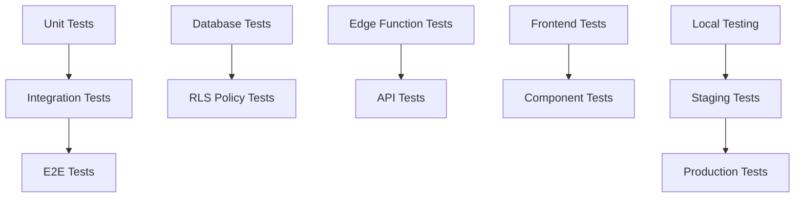

# 🧪 Testing Guide - Supabase + Vercel Stack

Comprehensive testing guide for the Digital Textile Printing Management System using Supabase and Vercel.

## 📋 Overview

This guide covers testing strategies for a **serverless stack**:
- 🗄️ **Database Testing** - Supabase PostgreSQL queries and policies
- ⚡ **Edge Function Testing** - Business logic validation
- 🔒 **Authentication Testing** - User access and permissions
- 🌐 **Frontend Testing** - React components and integration
- 📊 **API Testing** - Auto-generated endpoints
- 🔄 **Real-time Testing** - WebSocket subscriptions
- 🚀 **End-to-End Testing** - Complete user workflows

## 🏗️ Testing Architecture



## 📚 Table of Contents

1. [🛠️ Test Setup](#test-setup)
2. [🗄️ Database Testing](#database-testing)
3. [⚡ Edge Function Testing](#edge-function-testing)
4. [🔒 Authentication Testing](#authentication-testing)
5. [🌐 Frontend Testing](#frontend-testing)
6. [📊 API Testing](#api-testing)
7. [🔄 Real-time Testing](#real-time-testing)
8. [🚀 End-to-End Testing](#end-to-end-testing)
9. [📈 Performance Testing](#performance-testing)
10. [🔒 Security Testing](#security-testing)
11. [🎯 Test Automation](#test-automation)

---

## 🛠️ Test Setup

### **Prerequisites**
```bash
# Required tools
Node.js 16+
npm or yarn
Supabase CLI
```

### **Test Environment Setup**

1. **Install Testing Dependencies**
```bash
cd frontend
npm install --save-dev \
  @testing-library/react \
  @testing-library/jest-dom \
  @testing-library/user-event \
  jest \
  jest-environment-jsdom \
  msw \
  cypress \
  @supabase/supabase-js
```

2. **Create Test Configuration**
```javascript
// jest.config.js
module.exports = {
  testEnvironment: 'jsdom',
  setupFilesAfterEnv: ['<rootDir>/src/setupTests.js'],
  moduleNameMapping: {
    '^@/(.*)$': '<rootDir>/src/$1'
  },
  collectCoverageFrom: [
    'src/**/*.{js,jsx,ts,tsx}',
    '!src/index.js',
    '!src/reportWebVitals.js'
  ]
}
```

3. **Setup Test Environment Variables**
```bash
# .env.test
NEXT_PUBLIC_SUPABASE_URL=http://localhost:54321
NEXT_PUBLIC_SUPABASE_ANON_KEY=test_anon_key
NEXT_PUBLIC_ENVIRONMENT=test
```

4. **Local Supabase for Testing**
```bash
# Start local Supabase
supabase start

# Apply test schema
supabase db reset
```

---

## 🗄️ Database Testing

### **Schema Validation Tests**

```sql
-- Test: Verify all tables exist
SELECT table_name FROM information_schema.tables 
WHERE table_schema = 'public' 
AND table_name IN (
  'users', 'customers', 'orders', 'order_items',
  'material_in', 'delivery_challans', 'gst_invoices',
  'payments', 'returns', 'inventory', 'expenses'
);

-- Expected: 11 tables
```

### **Data Integrity Tests**

```sql
-- Test: Foreign key constraints
INSERT INTO orders (order_number, customer_id, status) 
VALUES ('TEST-001', '00000000-0000-0000-0000-000000000000', 'pending');
-- Expected: ERROR - customer_id does not exist

-- Test: Check constraints
INSERT INTO order_items (order_id, material_type, quantity, unit_price) 
VALUES ('valid-uuid', 'saree', -1, 100);
-- Expected: ERROR - quantity must be > 0

-- Test: Unique constraints
INSERT INTO customers (name, phone) VALUES ('Test Customer', '1234567890');
INSERT INTO customers (name, phone) VALUES ('Another Customer', '1234567890');
-- Expected: ERROR - phone number must be unique
```

### **RLS Policy Tests**

```javascript
// Test: Authenticated users can read customers
const { data, error } = await supabaseAuth
  .from('customers')
  .select('*')
  .limit(1)

// Expected: Success with data
expect(error).toBeNull()
expect(data).toBeDefined()

// Test: Unauthenticated users cannot read customers
const { data: unauthData, error: unauthError } = await supabaseUnauth
  .from('customers')
  .select('*')

// Expected: No data returned
expect(unauthData).toEqual([])
```

### **Database Function Tests**

```sql
-- Test: Order number generation
SELECT generate_order_number() AS order_number;
-- Expected: Format ORD-YYYY-NNNN

-- Test: Trigger functions
INSERT INTO customers (name, phone) VALUES ('Test Customer', '9999999999');
SELECT created_at, updated_at FROM customers WHERE phone = '9999999999';
-- Expected: created_at and updated_at should be set
```

---

## ⚡ Edge Function Testing

### **Local Edge Function Testing**

```bash
# Start edge function locally
supabase functions serve orders

# Test endpoint
curl -X POST http://localhost:54321/functions/v1/orders \
  -H "Authorization: Bearer $SUPABASE_ANON_KEY" \
  -H "Content-Type: application/json" \
  -d '{
    "customer_id": "test-uuid",
    "items": [{
      "material_type": "saree",
      "quantity": 10,
      "unit_price": 500
    }]
  }'
```

### **Edge Function Unit Tests**

```typescript
// tests/edge-functions/orders.test.ts
import { createClient } from '@supabase/supabase-js'

describe('Orders Edge Function', () => {
  let supabase: any

  beforeAll(() => {
    supabase = createClient(
      'http://localhost:54321',
      process.env.SUPABASE_ANON_KEY!
    )
  })

  test('should create order with items', async () => {
    const orderData = {
      customer_id: 'test-customer-id',
      items: [
        {
          material_type: 'saree',
          quantity: 10,
          unit_price: 500
        }
      ]
    }

    const response = await fetch('http://localhost:54321/functions/v1/orders', {
      method: 'POST',
      headers: {
        'Authorization': `Bearer ${process.env.SUPABASE_ANON_KEY}`,
        'Content-Type': 'application/json'
      },
      body: JSON.stringify(orderData)
    })

    const result = await response.json()

    expect(response.status).toBe(200)
    expect(result.data).toBeDefined()
    expect(result.data.order_number).toMatch(/ORD-\d{4}-\d{4}/)
    expect(result.data.total_amount).toBe(5000)
  })

  test('should reject invalid order data', async () => {
    const invalidData = {
      customer_id: '',
      items: []
    }

    const response = await fetch('http://localhost:54321/functions/v1/orders', {
      method: 'POST',
      headers: {
        'Authorization': `Bearer ${process.env.SUPABASE_ANON_KEY}`,
        'Content-Type': 'application/json'
      },
      body: JSON.stringify(invalidData)
    })

    expect(response.status).toBe(400)
  })
})
```

---

## 🔒 Authentication Testing

### **Authentication Flow Tests**

```javascript
// tests/auth.test.js
import { createClient } from '@supabase/supabase-js'

describe('Authentication', () => {
  let supabase

  beforeEach(() => {
    supabase = createClient(
      process.env.NEXT_PUBLIC_SUPABASE_URL,
      process.env.NEXT_PUBLIC_SUPABASE_ANON_KEY
    )
  })

  test('should login with valid credentials', async () => {
    const { data, error } = await supabase.auth.signInWithPassword({
      email: 'admin@example.com',
      password: 'password123'
    })

    expect(error).toBeNull()
    expect(data.user).toBeDefined()
    expect(data.session).toBeDefined()
  })

  test('should reject invalid credentials', async () => {
    const { data, error } = await supabase.auth.signInWithPassword({
      email: 'admin@example.com',
      password: 'wrongpassword'
    })

    expect(error).toBeDefined()
    expect(data.user).toBeNull()
  })

  test('should logout successfully', async () => {
    // First login
    await supabase.auth.signInWithPassword({
      email: 'admin@example.com',
      password: 'password123'
    })

    // Then logout
    const { error } = await supabase.auth.signOut()
    
    expect(error).toBeNull()

    // Verify session is cleared
    const { data: { session } } = await supabase.auth.getSession()
    expect(session).toBeNull()
  })
})
```

### **Permission Tests**

```javascript
describe('User Permissions', () => {
  test('admin can access all data', async () => {
    // Login as admin
    await supabase.auth.signInWithPassword({
      email: 'admin@example.com',
      password: 'password123'
    })

    // Test access to sensitive data
    const { data, error } = await supabase
      .from('users')
      .select('*')

    expect(error).toBeNull()
    expect(data).toBeDefined()
  })

  test('employee has limited access', async () => {
    // Login as employee
    await supabase.auth.signInWithPassword({
      email: 'employee@example.com',
      password: 'password123'
    })

    // Test limited access (depends on RLS policies)
    const { data, error } = await supabase
      .from('customers')
      .select('*')

    expect(error).toBeNull()
    // Additional checks based on business rules
  })
})
```

---

## 🌐 Frontend Testing

### **Component Tests**

```javascript
// tests/components/CustomerForm.test.jsx
import { render, screen, fireEvent, waitFor } from '@testing-library/react'
import userEvent from '@testing-library/user-event'
import CustomerForm from '../src/components/CustomerForm'

// Mock Supabase
jest.mock('../src/lib/supabase', () => ({
  supabase: {
    from: jest.fn(() => ({
      insert: jest.fn(() => ({
        select: jest.fn(() => ({
          single: jest.fn(() => Promise.resolve({
            data: { id: 'test-id', name: 'Test Customer' },
            error: null
          }))
        }))
      }))
    }))
  }
}))

describe('CustomerForm', () => {
  test('renders form fields', () => {
    render(<CustomerForm />)
    
    expect(screen.getByLabelText('Customer Name')).toBeInTheDocument()
    expect(screen.getByLabelText('Phone Number')).toBeInTheDocument()
    expect(screen.getByLabelText('Email')).toBeInTheDocument()
    expect(screen.getByRole('button', { name: 'Save Customer' })).toBeInTheDocument()
  })

  test('submits form with valid data', async () => {
    const user = userEvent.setup()
    const onSave = jest.fn()
    
    render(<CustomerForm onSave={onSave} />)
    
    await user.type(screen.getByLabelText('Customer Name'), 'Test Customer')
    await user.type(screen.getByLabelText('Phone Number'), '9876543210')
    await user.type(screen.getByLabelText('Email'), 'test@example.com')
    
    await user.click(screen.getByRole('button', { name: 'Save Customer' }))
    
    await waitFor(() => {
      expect(onSave).toHaveBeenCalledWith({
        name: 'Test Customer',
        phone: '9876543210',
        email: 'test@example.com'
      })
    })
  })

  test('shows validation errors', async () => {
    const user = userEvent.setup()
    
    render(<CustomerForm />)
    
    // Submit without required fields
    await user.click(screen.getByRole('button', { name: 'Save Customer' }))
    
    await waitFor(() => {
      expect(screen.getByText('Customer name is required')).toBeInTheDocument()
    })
  })
})
```

### **Hook Tests**

```javascript
// tests/hooks/useCustomers.test.js
import { renderHook, waitFor } from '@testing-library/react'
import { useCustomers } from '../src/hooks/useCustomers'

// Mock data
const mockCustomers = [
  { id: '1', name: 'Customer 1', phone: '1111111111' },
  { id: '2', name: 'Customer 2', phone: '2222222222' }
]

// Mock Supabase
jest.mock('../src/lib/supabase', () => ({
  supabase: {
    from: jest.fn(() => ({
      select: jest.fn(() => ({
        eq: jest.fn(() => ({
          order: jest.fn(() => Promise.resolve({
            data: mockCustomers,
            error: null
          }))
        }))
      }))
    }))
  }
}))

describe('useCustomers', () => {
  test('fetches customers successfully', async () => {
    const { result } = renderHook(() => useCustomers())
    
    expect(result.current.loading).toBe(true)
    
    await waitFor(() => {
      expect(result.current.loading).toBe(false)
    })
    
    expect(result.current.customers).toEqual(mockCustomers)
    expect(result.current.error).toBeNull()
  })
})
```

### **Integration Tests**

```javascript
// tests/integration/CustomerManagement.test.jsx
import { render, screen, waitFor } from '@testing-library/react'
import userEvent from '@testing-library/user-event'
import { BrowserRouter } from 'react-router-dom'
import CustomerManagement from '../src/pages/CustomerManagement'
import { SupabaseProvider } from '../src/contexts/SupabaseContext'

const renderWithProviders = (component) => {
  return render(
    <BrowserRouter>
      <SupabaseProvider>
        {component}
      </SupabaseProvider>
    </BrowserRouter>
  )
}

describe('Customer Management Integration', () => {
  test('complete customer creation flow', async () => {
    const user = userEvent.setup()
    
    renderWithProviders(<CustomerManagement />)
    
    // Click add customer button
    await user.click(screen.getByRole('button', { name: 'Add Customer' }))
    
    // Fill form
    await user.type(screen.getByLabelText('Customer Name'), 'Integration Test Customer')
    await user.type(screen.getByLabelText('Phone Number'), '9999999999')
    
    // Submit form
    await user.click(screen.getByRole('button', { name: 'Save Customer' }))
    
    // Verify customer appears in list
    await waitFor(() => {
      expect(screen.getByText('Integration Test Customer')).toBeInTheDocument()
    })
  })
})
```

---

## 📊 API Testing

### **REST API Tests**

```javascript
// tests/api/customers.test.js
import { createClient } from '@supabase/supabase-js'

describe('Customers API', () => {
  let supabase
  let testCustomer

  beforeAll(() => {
    supabase = createClient(
      process.env.NEXT_PUBLIC_SUPABASE_URL,
      process.env.NEXT_PUBLIC_SUPABASE_ANON_KEY
    )
  })

  beforeEach(async () => {
    // Clean up and create test customer
    await supabase.from('customers').delete().eq('phone', 'TEST_PHONE')
    
    const { data } = await supabase
      .from('customers')
      .insert([{
        name: 'Test Customer',
        phone: 'TEST_PHONE',
        email: 'test@example.com'
      }])
      .select()
      .single()
    
    testCustomer = data
  })

  afterEach(async () => {
    // Clean up
    await supabase.from('customers').delete().eq('id', testCustomer.id)
  })

  test('GET /customers - should return all customers', async () => {
    const { data, error } = await supabase
      .from('customers')
      .select('*')
      .eq('is_deleted', false)

    expect(error).toBeNull()
    expect(Array.isArray(data)).toBe(true)
    expect(data.length).toBeGreaterThan(0)
  })

  test('GET /customers/:id - should return specific customer', async () => {
    const { data, error } = await supabase
      .from('customers')
      .select('*')
      .eq('id', testCustomer.id)
      .single()

    expect(error).toBeNull()
    expect(data.id).toBe(testCustomer.id)
    expect(data.name).toBe('Test Customer')
  })

  test('POST /customers - should create new customer', async () => {
    const newCustomer = {
      name: 'New Test Customer',
      phone: 'NEW_TEST_PHONE',
      email: 'newtest@example.com'
    }

    const { data, error } = await supabase
      .from('customers')
      .insert([newCustomer])
      .select()
      .single()

    expect(error).toBeNull()
    expect(data.name).toBe(newCustomer.name)
    expect(data.phone).toBe(newCustomer.phone)

    // Clean up
    await supabase.from('customers').delete().eq('id', data.id)
  })

  test('PUT /customers/:id - should update customer', async () => {
    const updates = {
      name: 'Updated Test Customer',
      email: 'updated@example.com'
    }

    const { data, error } = await supabase
      .from('customers')
      .update(updates)
      .eq('id', testCustomer.id)
      .select()
      .single()

    expect(error).toBeNull()
    expect(data.name).toBe(updates.name)
    expect(data.email).toBe(updates.email)
  })

  test('DELETE /customers/:id - should soft delete customer', async () => {
    const { error } = await supabase
      .from('customers')
      .update({ is_deleted: true })
      .eq('id', testCustomer.id)

    expect(error).toBeNull()

    // Verify customer is soft deleted
    const { data } = await supabase
      .from('customers')
      .select('*')
      .eq('id', testCustomer.id)
      .single()

    expect(data.is_deleted).toBe(true)
  })
})
```

### **GraphQL API Tests**

```javascript
// tests/api/graphql.test.js
describe('GraphQL API', () => {
  test('should query customers with relations', async () => {
    const query = `
      query GetCustomersWithOrders {
        customersCollection(filter: { is_deleted: { eq: false } }) {
          edges {
            node {
              id
              name
              phone
              ordersCollection {
                edges {
                  node {
                    order_number
                    status
                    total_amount
                  }
                }
              }
            }
          }
        }
      }
    `

    const { data, error } = await supabase
      .rpc('graphql', { query })

    expect(error).toBeNull()
    expect(data.customersCollection).toBeDefined()
  })
})
```

---

## 🔄 Real-time Testing

### **Subscription Tests**

```javascript
// tests/realtime/subscriptions.test.js
describe('Real-time Subscriptions', () => {
  test('should receive order updates', (done) => {
    const subscription = supabase
      .channel('orders')
      .on('postgres_changes', 
        { 
          event: 'INSERT', 
          schema: 'public', 
          table: 'orders' 
        }, 
        (payload) => {
          expect(payload.new).toBeDefined()
          expect(payload.new.order_number).toBeDefined()
          subscription.unsubscribe()
          done()
        }
      )
      .subscribe()

    // Trigger an insert
    setTimeout(async () => {
      await supabase
        .from('orders')
        .insert([{
          order_number: 'TEST-ORDER-001',
          customer_id: 'test-customer-id',
          status: 'pending'
        }])
    }, 100)
  })

  test('should handle subscription errors', (done) => {
    const subscription = supabase
      .channel('invalid_table')
      .on('postgres_changes', 
        { 
          event: 'INSERT', 
          schema: 'public', 
          table: 'nonexistent_table' 
        }, 
        () => {}
      )
      .subscribe((status, err) => {
        if (status === 'SUBSCRIPTION_ERROR') {
          expect(err).toBeDefined()
          subscription.unsubscribe()
          done()
        }
      })
  })
})
```

---

## 🚀 End-to-End Testing

### **Cypress E2E Tests**

```javascript
// cypress/e2e/customer-management.cy.js
describe('Customer Management E2E', () => {
  beforeEach(() => {
    // Login before each test
    cy.visit('/login')
    cy.get('[data-testid=email-input]').type('admin@example.com')
    cy.get('[data-testid=password-input]').type('password123')
    cy.get('[data-testid=login-button]').click()
    
    // Wait for redirect to dashboard
    cy.url().should('include', '/dashboard')
  })

  it('should create a new customer', () => {
    // Navigate to customers page
    cy.visit('/customers')
    
    // Click add customer button
    cy.get('[data-testid=add-customer-button]').click()
    
    // Fill customer form
    cy.get('[data-testid=customer-name-input]').type('E2E Test Customer')
    cy.get('[data-testid=customer-phone-input]').type('9876543210')
    cy.get('[data-testid=customer-email-input]').type('e2e@example.com')
    cy.get('[data-testid=customer-address-input]').type('123 Test Street')
    
    // Submit form
    cy.get('[data-testid=save-customer-button]').click()
    
    // Verify success message
    cy.get('[data-testid=success-message]').should('contain', 'Customer created successfully')
    
    // Verify customer appears in list
    cy.get('[data-testid=customer-list]').should('contain', 'E2E Test Customer')
  })

  it('should create an order for customer', () => {
    // Assume customer exists from previous test
    cy.visit('/customers')
    
    // Click on customer
    cy.get('[data-testid=customer-row]').first().click()
    
    // Create new order
    cy.get('[data-testid=create-order-button]').click()
    
    // Add order items
    cy.get('[data-testid=add-item-button]').click()
    cy.get('[data-testid=material-type-select]').select('saree')
    cy.get('[data-testid=quantity-input]').type('10')
    cy.get('[data-testid=unit-price-input]').type('500')
    
    // Submit order
    cy.get('[data-testid=save-order-button]').click()
    
    // Verify order created
    cy.get('[data-testid=success-message]').should('contain', 'Order created successfully')
    cy.url().should('include', '/orders')
  })

  it('should complete production workflow', () => {
    // Navigate to production page
    cy.visit('/production')
    
    // Find pending item
    cy.get('[data-testid=production-item]').first().within(() => {
      // Update stage to printing
      cy.get('[data-testid=stage-select]').select('printing')
      cy.get('[data-testid=update-stage-button]').click()
    })
    
    // Verify stage updated
    cy.get('[data-testid=success-message]').should('contain', 'Production stage updated')
  })
})
```

### **Playwright E2E Tests**

```javascript
// tests/e2e/order-workflow.spec.js
import { test, expect } from '@playwright/test'

test.describe('Order Workflow', () => {
  test.beforeEach(async ({ page }) => {
    // Login
    await page.goto('/login')
    await page.fill('[data-testid=email-input]', 'admin@example.com')
    await page.fill('[data-testid=password-input]', 'password123')
    await page.click('[data-testid=login-button]')
    await page.waitForURL('**/dashboard')
  })

  test('complete order workflow', async ({ page }) => {
    // 1. Create customer
    await page.goto('/customers')
    await page.click('[data-testid=add-customer-button]')
    await page.fill('[data-testid=customer-name-input]', 'Workflow Test Customer')
    await page.fill('[data-testid=customer-phone-input]', '9999999999')
    await page.click('[data-testid=save-customer-button]')
    
    await expect(page.locator('[data-testid=success-message]')).toContainText('Customer created')
    
    // 2. Create order
    await page.click('[data-testid=create-order-button]')
    await page.click('[data-testid=add-item-button]')
    await page.selectOption('[data-testid=material-type-select]', 'saree')
    await page.fill('[data-testid=quantity-input]', '5')
    await page.fill('[data-testid=unit-price-input]', '1000')
    await page.click('[data-testid=save-order-button]')
    
    await expect(page.locator('[data-testid=success-message]')).toContainText('Order created')
    
    // 3. Record material in
    await page.goto('/materials')
    await page.click('[data-testid=material-in-tab]')
    await page.click('[data-testid=add-material-button]')
    await page.selectOption('[data-testid=customer-select]', 'Workflow Test Customer')
    await page.selectOption('[data-testid=material-type-select]', 'saree')
    await page.fill('[data-testid=quantity-input]', '5')
    await page.click('[data-testid=save-material-button]')
    
    // 4. Update production stages
    await page.goto('/production')
    const firstItem = page.locator('[data-testid=production-item]').first()
    await firstItem.locator('[data-testid=stage-select]').selectOption('printing')
    await firstItem.locator('[data-testid=update-stage-button]').click()
    
    // 5. Complete order
    await firstItem.locator('[data-testid=stage-select]').selectOption('post_process')
    await firstItem.locator('[data-testid=update-stage-button]').click()
    
    // 6. Create delivery challan
    await page.goto('/challans')
    await page.click('[data-testid=create-challan-button]')
    await page.selectOption('[data-testid=customer-select]', 'Workflow Test Customer')
    await page.click('[data-testid=add-challan-item-button]')
    await page.click('[data-testid=save-challan-button]')
    
    // 7. Create invoice
    await page.goto('/invoices')
    await page.click('[data-testid=create-invoice-button]')
    await page.selectOption('[data-testid=customer-select]', 'Workflow Test Customer')
    await page.click('[data-testid=add-challan-to-invoice]')
    await page.click('[data-testid=save-invoice-button]')
    
    // 8. Record payment
    await page.click('[data-testid=record-payment-button]')
    await page.fill('[data-testid=payment-amount-input]', '5900')
    await page.selectOption('[data-testid=payment-method-select]', 'cash')
    await page.click('[data-testid=save-payment-button]')
    
    // Verify workflow completion
    await expect(page.locator('[data-testid=success-message]')).toContainText('Payment recorded')
  })
})
```

---

## 📈 Performance Testing

### **Load Testing with Artillery**

```yaml
# artillery-config.yml
config:
  target: 'https://your-app.vercel.app'
  phases:
    - duration: 60
      arrivalRate: 10
    - duration: 120
      arrivalRate: 20
    - duration: 60
      arrivalRate: 5

scenarios:
  - name: "Customer Management"
    weight: 50
    flow:
      - post:
          url: "/api/auth/login"
          json:
            email: "test@example.com"
            password: "password123"
          capture:
            - json: "$.access_token"
              as: "token"
      - get:
          url: "/api/customers"
          headers:
            Authorization: "Bearer {{ token }}"
      - post:
          url: "/api/customers"
          headers:
            Authorization: "Bearer {{ token }}"
          json:
            name: "Load Test Customer {{ $randomString() }}"
            phone: "{{ $randomInt(1000000000, 9999999999) }}"

  - name: "Order Creation"
    weight: 30
    flow:
      - post:
          url: "/api/auth/login"
          json:
            email: "test@example.com"
            password: "password123"
          capture:
            - json: "$.access_token"
              as: "token"
      - post:
          url: "/functions/v1/orders"
          headers:
            Authorization: "Bearer {{ token }}"
          json:
            customer_id: "{{ $randomUUID() }}"
            items:
              - material_type: "saree"
                quantity: 10
                unit_price: 500
```

### **Database Performance Tests**

```sql
-- Test: Query performance with explain analyze
EXPLAIN ANALYZE 
SELECT o.*, c.name as customer_name 
FROM orders o 
JOIN customers c ON o.customer_id = c.id 
WHERE o.status = 'pending' 
AND o.created_at >= NOW() - INTERVAL '30 days';

-- Expected: Query should complete under 100ms

-- Test: Index usage
EXPLAIN (FORMAT JSON)
SELECT * FROM customers WHERE phone = '9876543210';

-- Expected: Should use index scan, not seq scan
```

### **Frontend Performance Tests**

```javascript
// tests/performance/lighthouse.test.js
import lighthouse from 'lighthouse'
import chromeLauncher from 'chrome-launcher'

describe('Lighthouse Performance Tests', () => {
  let chrome

  beforeAll(async () => {
    chrome = await chromeLauncher.launch({ chromeFlags: ['--headless'] })
  })

  afterAll(async () => {
    await chrome.kill()
  })

  test('homepage should meet performance standards', async () => {
    const options = {
      logLevel: 'info',
      output: 'json',
      onlyCategories: ['performance'],
      port: chrome.port
    }

    const runnerResult = await lighthouse('http://localhost:3000', options)
    const { performance } = runnerResult.lhr.categories

    expect(performance.score).toBeGreaterThan(0.8) // 80+ score
  })
})
```

---

## 🔒 Security Testing

### **Authentication Security Tests**

```javascript
// tests/security/auth.test.js
describe('Authentication Security', () => {
  test('should prevent SQL injection in login', async () => {
    const maliciousEmail = "admin@example.com'; DROP TABLE users; --"
    
    const { data, error } = await supabase.auth.signInWithPassword({
      email: maliciousEmail,
      password: 'password123'
    })

    expect(error).toBeDefined()
    expect(data.user).toBeNull()
    
    // Verify users table still exists
    const { data: users } = await supabase.from('users').select('count')
    expect(users).toBeDefined()
  })

  test('should enforce rate limiting', async () => {
    const attemptLogin = () => supabase.auth.signInWithPassword({
      email: 'wrong@example.com',
      password: 'wrongpassword'
    })

    // Make multiple failed attempts
    const promises = Array(10).fill().map(attemptLogin)
    const results = await Promise.all(promises)

    // Should get rate limited after several attempts
    const rateLimitedAttempts = results.filter(
      result => result.error?.message.includes('rate limit')
    )
    
    expect(rateLimitedAttempts.length).toBeGreaterThan(0)
  })
})
```

### **RLS Security Tests**

```javascript
// tests/security/rls.test.js
describe('Row Level Security', () => {
  test('should prevent unauthorized data access', async () => {
    // Create unauthenticated client
    const unauthClient = createClient(
      process.env.NEXT_PUBLIC_SUPABASE_URL,
      process.env.NEXT_PUBLIC_SUPABASE_ANON_KEY
    )

    const { data, error } = await unauthClient
      .from('customers')
      .select('*')

    // Should return empty array or error due to RLS
    expect(data).toEqual([])
  })

  test('should enforce user-based data isolation', async () => {
    // Test that users can only see their own data
    // (Implementation depends on your RLS policies)
  })
})
```

### **Input Validation Tests**

```javascript
// tests/security/validation.test.js
describe('Input Validation', () => {
  test('should sanitize customer input', async () => {
    const maliciousInput = {
      name: '<script>alert("xss")</script>',
      phone: '9876543210',
      email: 'test@example.com'
    }

    const { data, error } = await supabase
      .from('customers')
      .insert([maliciousInput])
      .select()
      .single()

    expect(error).toBeNull()
    // Verify script tags are escaped or removed
    expect(data.name).not.toContain('<script>')
  })

  test('should validate required fields', async () => {
    const invalidData = {
      name: '', // Required field empty
      phone: '9876543210'
    }

    const { data, error } = await supabase
      .from('customers')
      .insert([invalidData])

    expect(error).toBeDefined()
    expect(error.message).toContain('null value')
  })
})
```

---

## 🎯 Test Automation

### **GitHub Actions CI/CD**

```yaml
# .github/workflows/test.yml
name: Test Suite

on:
  push:
    branches: [main, develop]
  pull_request:
    branches: [main]

jobs:
  test:
    runs-on: ubuntu-latest
    
    services:
      postgres:
        image: postgres:14
        env:
          POSTGRES_PASSWORD: postgres
          POSTGRES_DB: test_db
        options: >-
          --health-cmd pg_isready
          --health-interval 10s
          --health-timeout 5s
          --health-retries 5

    steps:
      - uses: actions/checkout@v3
      
      - name: Setup Node.js
        uses: actions/setup-node@v3
        with:
          node-version: '18'
          cache: 'npm'
          cache-dependency-path: frontend/package-lock.json
      
      - name: Install dependencies
        working-directory: frontend
        run: npm ci
      
      - name: Setup Supabase CLI
        run: |
          npm install -g supabase
          supabase start
      
      - name: Run tests
        working-directory: frontend
        run: |
          npm run test:unit
          npm run test:integration
        env:
          NEXT_PUBLIC_SUPABASE_URL: http://localhost:54321
          NEXT_PUBLIC_SUPABASE_ANON_KEY: ${{ secrets.SUPABASE_ANON_KEY }}
      
      - name: Run E2E tests
        working-directory: frontend
        run: npm run test:e2e
        env:
          CYPRESS_baseUrl: http://localhost:3000
      
      - name: Upload coverage
        uses: codecov/codecov-action@v3
        with:
          files: frontend/coverage/lcov.info
```

### **Test Scripts**

```json
// package.json scripts
{
  "scripts": {
    "test": "jest",
    "test:watch": "jest --watch",
    "test:coverage": "jest --coverage",
    "test:unit": "jest --testPathPattern=unit",
    "test:integration": "jest --testPathPattern=integration",
    "test:e2e": "cypress run",
    "test:e2e:open": "cypress open",
    "test:security": "jest --testPathPattern=security",
    "test:performance": "jest --testPathPattern=performance",
    "test:all": "npm run test:unit && npm run test:integration && npm run test:e2e"
  }
}
```

### **Pre-commit Hooks**

```yaml
# .pre-commit-config.yaml
repos:
  - repo: local
    hooks:
      - id: tests
        name: Run tests
        entry: npm run test:unit
        language: system
        pass_filenames: false
        always_run: true
      
      - id: lint
        name: Lint code
        entry: npm run lint
        language: system
        files: \.(js|jsx|ts|tsx)$
      
      - id: type-check
        name: Type check
        entry: npm run type-check
        language: system
        files: \.(ts|tsx)$
```

---

## 📊 Test Coverage

### **Coverage Requirements**

```javascript
// jest.config.js
module.exports = {
  collectCoverageFrom: [
    'src/**/*.{js,jsx,ts,tsx}',
    '!src/index.js',
    '!src/**/*.test.{js,jsx,ts,tsx}',
    '!src/**/*.stories.{js,jsx,ts,tsx}'
  ],
  coverageThreshold: {
    global: {
      branches: 80,
      functions: 80,
      lines: 80,
      statements: 80
    }
  }
}
```

### **Coverage Reports**

```bash
# Generate coverage report
npm run test:coverage

# View coverage report
open coverage/lcov-report/index.html
```

---

## 🔍 Debugging Tests

### **Debug Jest Tests**

```bash
# Run tests in debug mode
node --inspect-brk node_modules/.bin/jest --runInBand

# Debug specific test
node --inspect-brk node_modules/.bin/jest --runInBand tests/components/CustomerForm.test.js
```

### **Debug Cypress Tests**

```javascript
// Add debugger in test
it('should debug this test', () => {
  cy.visit('/customers')
  cy.get('[data-testid=add-customer-button]').click()
  cy.debug() // Pauses test execution
  cy.get('[data-testid=customer-name-input]').type('Debug Customer')
})
```

### **Test Utilities**

```javascript
// tests/utils/testUtils.js
import { render } from '@testing-library/react'
import { BrowserRouter } from 'react-router-dom'
import { SupabaseProvider } from '../../src/contexts/SupabaseContext'

// Custom render function with providers
export function renderWithProviders(ui, options = {}) {
  const {
    initialEntries = ['/'],
    ...renderOptions
  } = options

  function Wrapper({ children }) {
    return (
      <BrowserRouter>
        <SupabaseProvider>
          {children}
        </SupabaseProvider>
      </BrowserRouter>
    )
  }

  return render(ui, { wrapper: Wrapper, ...renderOptions })
}

// Mock Supabase client
export const mockSupabase = {
  auth: {
    signInWithPassword: jest.fn(),
    signOut: jest.fn(),
    getUser: jest.fn(),
    getSession: jest.fn()
  },
  from: jest.fn(() => ({
    select: jest.fn(() => ({
      eq: jest.fn(() => ({
        order: jest.fn(() => Promise.resolve({ data: [], error: null }))
      }))
    })),
    insert: jest.fn(() => ({
      select: jest.fn(() => ({
        single: jest.fn(() => Promise.resolve({ data: {}, error: null }))
      }))
    }))
  }))
}
```

---

## 📝 Test Documentation

### **Test Plan Template**

```markdown
# Test Plan: Feature Name

## Objective
What functionality is being tested?

## Scope
- ✅ In scope: List what will be tested
- ❌ Out of scope: List what won't be tested

## Test Cases
1. **Test Case 1**: Description
   - **Steps**: 1. Step one 2. Step two
   - **Expected**: Expected result
   - **Actual**: Actual result
   - **Status**: Pass/Fail

## Test Data
- Required test data and setup

## Environment
- Test environment details

## Risks
- Potential risks and mitigation
```

### **Test Results Template**

```markdown
# Test Results: Release Version

## Summary
- **Total Tests**: 150
- **Passed**: 148
- **Failed**: 2
- **Skipped**: 0
- **Coverage**: 85%

## Test Breakdown
- **Unit Tests**: 80/80 ✅
- **Integration Tests**: 35/35 ✅
- **E2E Tests**: 25/25 ✅
- **Security Tests**: 8/10 ⚠️

## Failed Tests
1. **Test Name**: Reason for failure
2. **Test Name**: Reason for failure

## Recommendations
- Fix failing security tests before release
- Increase coverage for payment module
```

---

## 🎉 Success Criteria

### **Definition of Done**
- [ ] All unit tests pass
- [ ] Integration tests pass
- [ ] E2E tests pass
- [ ] Security tests pass
- [ ] Performance tests meet requirements
- [ ] Code coverage > 80%
- [ ] No high-severity security vulnerabilities
- [ ] All test documentation updated

### **Quality Gates**
- **Code Coverage**: Minimum 80%
- **Performance**: Page load < 3 seconds
- **Security**: No critical vulnerabilities
- **Accessibility**: WCAG 2.1 AA compliance
- **Browser Support**: Chrome, Firefox, Safari, Edge

---

## 📞 Support & Resources

- **Supabase Testing Docs**: [Testing Guide](https://supabase.com/docs/guides/testing)
- **React Testing Library**: [RTL Docs](https://testing-library.com/docs/react-testing-library/intro/)
- **Cypress Documentation**: [Cypress Docs](https://docs.cypress.io/)
- **Jest Documentation**: [Jest Docs](https://jestjs.io/docs/getting-started)

**Happy testing! 🧪**