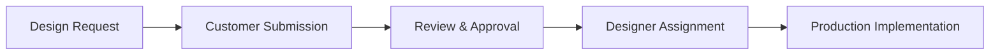
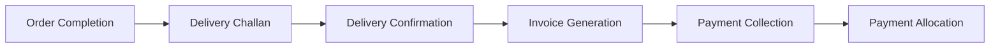

# Textile Manufacturing Management System
## Complete Business Workflow & Data Flow Documentation

### 🏢 System Overview

This is a comprehensive **Textile/Garment Manufacturing Management System** designed for custom textile printing operations. The system handles the complete business lifecycle from order booking to delivery and payment collection, specializing in textile products like sarees, dupattas, vonis, running materials, and blouse materials.

---

## 📋 Core Business Entities

### Primary Entities
| Entity | Description | Key Attributes |
|--------|-------------|----------------|
| **Customers** | Textile business clients | Contact details, GST numbers, addresses |
| **Orders** | Customer order requests | Priority, status, multiple items |
| **Order Items** | Individual items within orders | Material type, quantity, pricing |
| **Materials** | Raw materials from customers | Type, quantity, customer ownership |
| **Designs** | Customer-provided or library designs | Categories, complexity, compatibility |
| **Employees** | Staff (designers, workers, managers) | Roles, departments, performance tracking |
| **Delivery Challans** | Shipping documents | Delivery confirmation, tracking |
| **GST Invoices** | Financial invoices | Tax calculations, payment terms |
| **Payments** | Financial transactions | Multiple methods, allocation tracking |

---

## 🔄 Complete Business Workflow: Order-to-Delivery

### 1. 👥 **Customer Onboarding & Material Receipt**
```
Customer Registration → Material Intake → Stock Recording → Quality Check
```

**Process Details:**
- New customers registered with complete business details
- Raw materials (fabrics) received from customers
- Material stock tracked by customer and type
- Quality inspection before acceptance

**Data Flow:**
- Customer data → Customer database
- Material details → Material stock tables
- Quality reports → Quality control records

---

### 2. 📝 **Order Creation & Management**
```
Order Booking → Multi-item Creation → Priority Assignment → Status Tracking
```

**Process Details:**
- Orders created with multiple items
- Each item specifies: material type, quantity, pricing
- Priority levels: LOW, MEDIUM, HIGH, URGENT
- Status progression: `pending` → `in_progress` → `completed` → `cancelled`

**Data Flow:**
- Order data → Orders table
- Item details → Order_items table
- Status updates → Order tracking logs

---

### 3. 🎨 **Design Management Workflow**
```
Design Request → Customer Submission → Review & Approval → Production Ready
```

**3-Stage Design Status Process:**
1. **`pending_from_customer`** - Awaiting customer design submission
2. **`design_received_from_customer`** - Design received, under review
3. **`design_ready`** - Design approved and ready for production

**Design Library Features:**
- Reusable design templates
- Complexity levels: simple, medium, complex
- Material compatibility matrix
- Estimated production hours

**Designer Assignment System:**
- Workload distribution and capacity management
- Assignment progress tracking
- Deadline monitoring

**Data Flow:**
- Design files → Design library
- Assignment data → Designer workload tables
- Progress updates → Assignment tracking

---

### 4. 🏭 **Production Workflow**
```
Production Queue → Pre-treatment → Printing → Post-processing → Quality Control
```

**4-Stage Production Process:**
1. **`pending`** - Awaiting production start
2. **`pre_treatment`** - Material preparation phase
3. **`printing`** - Active printing/manufacturing
4. **`post_process`** - Final finishing and quality control

**Production Management:**
- Priority-based job scheduling
- Resource allocation to teams/machines
- Real-time progress tracking
- Quality ratings and standards

**Data Flow:**
- Production orders → Production queue
- Status updates → Production tracking
- Quality data → Quality control records

---

### 5. 📦 **Inventory & Stock Management**
```
Material Receipt → Allocation → Consumption → Stock Reconciliation
```

**Stock Tracking Components:**
- **Material Stock**: Customer-wise material inventory
- **Available Stock**: Real-time availability calculations
- **Allocated Stock**: Materials assigned to orders
- **Stock Movements**: Transfer and consumption tracking

**Design Quantity Management:**
- Design availability tracking
- Customer design utilization
- Design-to-production mapping

**Data Flow:**
- Stock transactions → Inventory tables
- Movement records → Stock history
- Alerts → Notification system

---

### 6. 🚚 **Delivery Management**
```
Delivery Scheduling → Challan Generation → Route Planning → Delivery Execution → Confirmation
```

**Delivery Process:**
- Delivery challans generated for completed items
- Route optimization for efficient delivery
- Real-time tracking and status updates
- Customer signature and photo evidence
- Exception handling (damage, loss, refusal)

**Data Flow:**
- Delivery schedules → Delivery planning tables
- Challan data → Delivery challans table
- Tracking updates → Delivery status logs
- Confirmations → Delivery completion records

---

### 7. 💰 **Financial Management**
```
Delivery Completion → Invoice Generation → Payment Processing → Allocation → Reconciliation
```

**Financial Processes:**
- **GST Invoice Generation**: Automated from delivery challans
- **Payment Methods**: Cash, UPI, Bank Transfer, Cheque, Card
- **Payment Allocation**: Smart distribution across multiple invoices
- **Outstanding Management**: Aging analysis and overdue tracking
- **Credit Notes**: Returns and adjustment handling

**Data Flow:**
- Delivery confirmations → Invoice generation triggers
- Invoice data → GST invoices table
- Payment records → Payment transactions
- Allocation data → Payment allocation tables

---

### 8. 👨‍💼 **Employee & Payroll Management**
```
Hiring → Role Assignment → Performance Tracking → Payroll Processing → Payment
```

**Employee Lifecycle:**
- Complete hiring and onboarding process
- Role-based access and responsibility assignment
- Performance tracking and evaluation

**Complex Payroll System:**
- **Earnings**: Base salary, overtime, bonuses, allowances
- **Deductions**: Tax, PF, ESI, loan deductions
- **Payment Schedules**: Monthly, weekly, daily options
- **Performance Incentives**: Designer completion rate bonuses

**Data Flow:**
- Employee data → Employee master tables
- Attendance → Timesheet records
- Performance metrics → Performance tracking
- Payroll calculations → Salary processing

---

## 🔄 Key Business Process Flows

### **Material Flow Process**


### **Design Workflow Process**


### **Production Pipeline**


### **Financial Cycle**


---

## 🏗️ Technology Architecture

### **Frontend Architecture**
- **Modular Design**: Separate pages for each business function
- **React Framework**: Modern, responsive user interface
- **Material-UI**: Professional component library
- **TypeScript**: Type-safe development

### **Key Modules**
| Module | Purpose | Key Features |
|--------|---------|--------------|
| **Dashboard** | Business overview | Real-time analytics, KPIs |
| **Customers** | Customer management | Registration, contact management |
| **Orders** | Order processing | Multi-item orders, status tracking |
| **Production** | Manufacturing control | Workflow stages, resource allocation |
| **Inventory** | Stock management | Real-time tracking, alerts |
| **Delivery** | Logistics management | Route planning, tracking |
| **Invoices** | Financial management | GST compliance, payment tracking |
| **Employees** | HR management | Payroll, performance tracking |

### **API Services**
- **Comprehensive APIs**: Full business logic exposure
- **Workflow APIs**: End-to-end process automation
- **Real-time Updates**: Live status tracking
- **Integration Ready**: External system connectivity

---

## 📊 Business Intelligence & Analytics

### **Dashboard Analytics**
- Real-time business performance overview
- Key performance indicators (KPIs)
- Trend analysis and forecasting

### **Reporting Capabilities**
- **Sales Reports**: Performance and trend analysis
- **Customer Analytics**: Profitability and volume metrics
- **Production Efficiency**: Throughput and quality metrics
- **Inventory Reports**: Stock movement and aging analysis
- **Financial Summaries**: Revenue, outstanding, and cash flow

### **Advanced Features**
- **Automated Workflows**: End-to-end process automation
- **Smart Alerts**: Proactive notifications for critical events
- **Route Optimization**: Delivery efficiency maximization
- **Payment Intelligence**: Smart allocation across multiple invoices

---

## ⚙️ Business Rules & Constraints

### **Operational Rules**
1. **Material Allocation**: Can only allocate if sufficient stock exists
2. **Design Prerequisites**: Production cannot start without approved designs
3. **Quality Gates**: Each production stage requires completion before proceeding
4. **Delivery Requirements**: Items must complete post-processing before delivery
5. **Financial Controls**: Invoices generated only after confirmed delivery
6. **Stock Integrity**: Regular reconciliation prevents discrepancies

### **Data Integrity Rules**
- **Referential Integrity**: All relationships properly maintained
- **Audit Trails**: Complete change history for all operations
- **Validation Rules**: Data quality and consistency enforcement
- **Security Controls**: Role-based access and data protection

---

## 🎯 Key Benefits

### **Operational Benefits**
- **Complete Digitization**: End-to-end digital workflow
- **Real-time Visibility**: Live tracking of all operations
- **Process Automation**: Reduced manual intervention
- **Quality Control**: Systematic quality management

### **Business Benefits**
- **Improved Efficiency**: Streamlined operations and reduced errors
- **Better Customer Service**: Real-time updates and faster delivery
- **Financial Control**: Accurate invoicing and payment tracking
- **Scalability**: System grows with business needs

### **Competitive Advantages**
- **Professional Operations**: Systematic and organized processes
- **Data-Driven Decisions**: Comprehensive analytics and reporting
- **Customer Satisfaction**: Transparent and efficient service delivery
- **Cost Optimization**: Resource utilization and waste reduction

---

## 🚀 Future Enhancement Opportunities

- **Mobile Applications**: Field operations and customer portals
- **IoT Integration**: Machine monitoring and automated data collection
- **AI/ML Integration**: Predictive analytics and demand forecasting
- **E-commerce Integration**: Online ordering and customer self-service
- **Advanced Scheduling**: AI-powered production optimization

---

*This system provides a complete digital transformation solution for textile manufacturing businesses, ensuring efficient workflow management, accurate tracking, and comprehensive business intelligence for informed decision-making.*